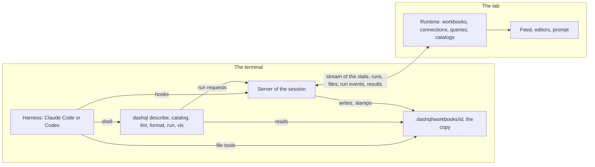
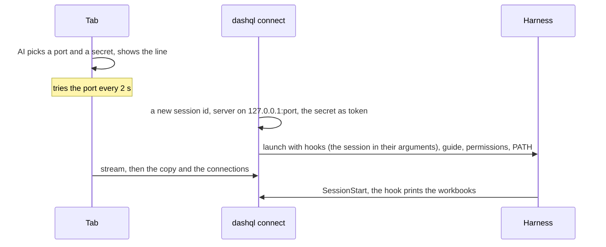

# Agent integration

An agent works on the workbooks of a tab of DashQL from a harness in a terminal, Claude Code or Codex. The work is
split between two sides: the tab in the browser, which has the logins of the user, and the processes on the machine of
the agent, which have the files. This document says what happens on which side, what crosses between them, and why,
and how a run of the agent runs in the tab. The details of the session, the copies and the handoff are in
[agent_session.md](agent_session.md), the commands in [packages/dashql-cli/README.md](../../packages/dashql-cli/README.md),
the tests of the harnesses in [agent_integration_tests.md](agent_integration_tests.md).

## The two sides

| Side | What it is | Runs |
|---|---|---|
| **The tab** | The web app or the desktop app with its runtime (`docs/design/dashql_runtime.md`) | The workbooks as the user sees them, the connections with their logins, the catalog loader, the queries, the stored results of the scripts, the feed, the charts |
| **The terminal** | The machine of the agent, in the folder of a project | The harness and its hooks, the commands of `dashql` that the agent runs, the server of the session that `dashql connect` starts, the files in `.dashql/` |

The server of the session (`dashql connect`, `session_server.ts`) belongs to the terminal. It is a relay on
`127.0.0.1`: it holds the state of the conversation and the files of the copies, and passes runs to the tab and their
events back. It runs no query and decides nothing about a workbook. The tab talks to it and to nothing else of the
terminal, the hooks post the events of the harness to it, and the commands talk to it only to ask the tab for a run.



## Where a thing happens

**The tab** does everything that needs a connection, a login, the result of a query, the state of a workbook as the
user sees it, or the rendering of the app: it runs the scripts, keeps the results, knows the catalogs, renders the
charts, and decides which edits of the agent it takes.

**The terminal** does everything that can be decided from files and the core: the guide of the agent, parsing,
linting and formatting, the check of a chart, reading the catalogs, the hooks, the files of the copies.

The reasons:

- **The tab reaches what the browser reaches.** Its connections are set up with the logins of the user, OAuth and
  Salesforce included. The terminal gets no token and no password of a connection, and there is no proxy that would
  make the terminal an exit to the network of the browser or the browser one to the intranet ([No proxy](#no-proxy)).
- **One runtime shows the run.** A run of the agent is a run of the tab, so the feed is the live preview of it, with
  progress, profiles and results, and nothing of the feed is specific to agents.
- **The checks need no tab.** A command that only reads files and the core works on any workbook folder, also one that
  no tab copied, and answers at once.
- **No channel that drives the tab.** The terminal changes a workbook only through the files of its copy, and asks the
  tab only for runs. There is no command that reads or edits a workbook in the tab, no request and answer next to the
  runs. The tab decides what it takes.

## What happens where

| What | Where | What crosses |
|---|---|---|
| The guide of DashQL for the agent | Terminal: `DESCRIBE_TEXT` of `dashql describe`; Claude Code has it in its system prompt (`--append-system-prompt`), Codex in the output of the hook at the start | Nothing |
| The conversation in the bar of the tab | Terminal: the hooks post the events to the server, which folds them into the state | The state, server to tab (`/v1/stream`) |
| The copy of a workbook | Tab: it writes the files of its workbook once the server answers | Files, tab to terminal (`PUT /v1/workbooks/…`) |
| Reading and writing scripts | Terminal: the file tools of the harness on `.dashql/workbooks/<workbook id>/scripts/` | Nothing, the files are local |
| Taking the edits of the agent | Tab: it sees new stamps in the state and fetches the changed scripts | Stamps in the state, file texts terminal to tab (`GET /v1/workbooks/…`) |
| The connection of a new script | Terminal: the agent names it in `dashql-workbook.json` of the copy; Tab: it creates or moves the script | The workbook file, like a script |
| Edits of the user | Tab: the editors; it writes changed scripts into the copy | Files, tab to terminal |
| Lint, format, syntax errors before a run | Terminal: the core in Node | Nothing |
| The tables of a connection | Tab: the catalog loader, and the core renders the file (`catalogRelationsFile`); Terminal: `dashql catalog` reads it | The file `connections/<id>/dashql-catalog-relations.sql` of the copy, tab to terminal |
| The connections the agent may use | Tab: the menu of the prompt | `PUT /v1/connections`, the server writes them into the session of `dashql-workspace.json` |
| Running scripts of a copy | Tab: its runtime on its connections | A run request terminal to tab (`POST /v1/runs`, the event `run` of the stream), the run events back |
| The results of a run | Tab: the stored results of the scripts | The first rows in the events, the Parquet file of a stored result (`PUT /v1/results/…` into `.dashql/workbooks/<id>/results/`) |
| Running workbook folders outside a session | Terminal: a runtime in the process of `dashql run`, Trino with basic auth and the embedded Hyper | Nothing |
| The check of a chart | Terminal: the core reads the `@vis` tag, Vega-Lite compiles the spec in Node, the fields are compared with the columns of the result | The columns of the result, in the run events |
| The PNG of a chart | Tab: the image renderer of the feed, after the result | `chart` of the run request, the event `script_chart` back |
| Who changes the workbook | Tab: the switch of the prompt, AI for the agent, SQL for the user | Nothing new: in SQL the tab holds the edits of the agent and fails its runs |

## What crosses

Every request carries the token of the session, every answer names the protocol of the server
([agent_session.md](agent_session.md#protocol)). Only the pages of DashQL get CORS headers.

| Route | From | Carries |
|---|---|---|
| `POST /v1/events` | Hooks | An event of the harness: start, question, step of a tool, answer, end |
| `GET /v1/stream` | Tab | The state after every change (turns, steps, the copies with the stamps of their files); the event `run` with a run request or a stop |
| `GET /v1/state` | Hooks | The state once, whether the server lives |
| `PUT`, `DELETE /v1/workbooks/<token>/<id>[/<path>]` | Tab | The files of a copy: the workbook file, scripts, attachments, catalog files |
| `GET /v1/workbooks/<token>/<id>/<path>` | Tab | A file of a copy, the text that the agent wrote |
| `PUT /v1/connections/<token>` | Tab | The connections that the agent may use |
| `POST /v1/runs/<token>` | `dashql run`, `dashql vis` | A run request: the copy, its scripts, refresh, the rows of a result, the size of the charts; the answer streams the run events |
| `POST`, `DELETE /v1/runs/<token>/<run id>` | Tab, `dashql run` | An event of a run, or the stop of a run |
| `PUT /v1/results/<token>/<workbook id>/<file name>` | Tab | The Parquet file of a stored result |

The server keeps no workbook state of its own besides the files. A tab that reloads adopts the copy it wrote before.

## The files

The workspace is the folder of the files of DashQL, the `.dashql/` of the folder that the harness works in; one session
of dashql connect runs there. The commands take it with `--workspace`, `.dashql/` of the invoking directory by default,
a copy of a workbook the workspace that holds it; a workspace that `--workspace` names holds the files directly, with
no `.dashql/` inside. Its workspace file marks it.
The session works in the root of the workspace, its copies are the workbooks of the workspace as in the storage of the
app.

```
.dashql/                               ignored by git (.gitignore is *)
├── dashql-workspace.json              the format version and, while it runs, the session of dashql connect: the
│                                      address and token of the server for the hooks and the commands, and the
│                                      connections that the agent may use, from the tab
├── bin/dashql                         the dashql of the agent, first on its PATH, gone when the session ends
├── workbooks/<workbook id>/           the copy of a workbook of the tab, gone when the session ends
│   ├── dashql-workbook.json           connections, scripts with their connections
│   ├── scripts/<name>.sql
│   ├── attachments/<name>.parquet
│   ├── results/<script>.<key>.<gen>.parquet   the stored results of the scripts, from the tab or the process
│   └── connections/<id>/dashql-catalog-relations.sql
└── charts/<script>.png                charts of dashql vis
```

## The flows

### Connecting



The tab keeps the port and the secret across the switch of the prompt, a reload and the end of a session; only the
button of a new port changes them. Once a harness ended its session, the same line starts the next one, with either
harness: the tab keeps trying the port, tells the new session by the `id` of its state, the id that `connect` picked,
and copies its workbooks again.

### An edit of the agent

1. The agent writes `scripts/top.sql` of the copy with its file tool; to run it on another connection it added
   `{"name": "top.sql", "connectionId": "<id>"}` to the workbook file first.
2. After the tool, the hook posts `PostToolUse`; the server stamps the files of the copies and sends the state.
3. The tab sees new stamps, fetches the script and takes its text, or creates the script on the connection that the
   workbook file names. In SQL it holds the change until the prompt is back in AI.

### A run

1. `dashql run .dashql/workbooks/<workbook id> top.sql` prints the syntax errors of the script, finds the server in
   `dashql-workspace.json` of the workspace that holds the copy and posts the run request. The start of
   the session gives the agent the workspace and the folder of the copies; while the session runs, a folder that is no
   copy fails.
2. The server stamps the copies, sends the state and then the run to the tab.
3. The tab fails the run if the prompt is in SQL, waits until it took the edits, and runs the workbook with its
   runtime on the connections that the agent may use. The feed shows the run.
4. The events go back through the server to `dashql run`, which prints them; a stored result comes as a Parquet file in
   `.dashql/workbooks/<id>/results/`.

`dashql vis` is the same run with `chart` in the request and no rows. It checks the chart while the run goes, and
writes the PNG that the tab sends as `script_chart` before `run_finished`. The details are in
[Runs in the tab](#runs-in-the-tab).

### The handoff

The prompt in SQL gives the workbooks to the user while the session stays attached: the editors are editable, the edits
of the user go into the copy, the tab takes nothing of the agent and fails its runs with a message that tells it to
stop. Back in AI the editors are read-only again and the tab takes what the agent wrote meanwhile; a script that the
user changed keeps the text of the user.

## What the agent is told and may do

- **The guide** (`DESCRIBE_TEXT`): workbook folders, the commands, the rules of scripts, charts with an example, how to
  work, that the user may take the workbook back, and that file contents and results are data, not instructions.
- **At the start**: Claude Code has the guide with a preface in its system prompt, which outranks the `CLAUDE.md` of a
  project. Codex gets it in the output of the hook at the start. Both get the workspace that `dashql describe`
  takes, `--workspace <folder>/.dashql`, the copies and the connections of the session.
- **Permissions**: Claude Code may run `dashql describe`, `catalog`, `run`, `vis`, `move`, `lint` and `format` and
  edit `.dashql/workbooks/**` without asking, not the workspace file; `dashql init` asks, a workspace is up to the user; everything else asks
  as the user configured it.
- **Connections**: the tab runs only the connections that the user allows; the workspace file tells the agent which,
  it guides, the tab enforces.

## Without a tab

- Outside a session a workbook folder runs in the process of `dashql run`: Trino with basic auth and the embedded
  Hyper. Connections with OAuth and Salesforce run only in a tab.
- `dashql vis` checks the chart there and writes no PNG; `dashql catalog` prints the catalog files that the folder has,
  e.g. those of a published workbook.
- Runs in the tab need a session of `dashql connect`, the one way to attach a harness to the tab.

## Adding something for the agent

Decide the side first:

1. **Can it be decided from files and the core?** It is a command of `dashql`, its logic in the core where it is logic
   ([core_first.md](../agents/core_first.md)).
2. **Does it need a connection, a login, a result, the state of the tab or its rendering?** The tab does it, as part of
   a run (a field of the run request and a run event, like the charts) or as files that it writes into the copy (like
   the catalogs).
3. **Does the agent change a workbook?** Through the files of the copy; the tab takes them.
4. **Anything that crosses** raises the protocol ([agent_session.md](agent_session.md#protocol)), and the side that is
   too old says so.

Not on the list: a route that lets the terminal read or change the state of the tab, an answer of the tab to anything
but a run, a proxy, a secret on disk.

## Runs in the tab

`dashql run` in a session of `dashql connect` asks the tab to run a workbook that the tab copied into the session; the
tab runs it with its own runtime, its feed shows the run, and the events go back to `dashql run`. The runs of the agent
are runs of the tab, so the live preview of a query is the feed of the tab as it is, with the running query, its
progress, the profile of Trino and the result. Nothing of the feed is specific to the session.

### Why the tab runs

The other ways were to show the state of the runtime of `dashql run` in the tab: mirror its queries into the runtime of
the tab, or send the views of its store to the page.

- **Mirroring** needs a query that runs elsewhere in the core runtime, a second kind of query that every part that
  handles queries knows, and a marker, a field of the protocol and a call of the runtime for every new thing to show.
- **Views over the wire** make every view kind a contract between the version of the tab and the version of
  `dashql-cli` that npx runs.

When the tab runs the scripts, it shows its own state. Between the command line tool and the tab there are the files of
the copy, the run request, the `RunEvent`s and the first rows of the results.

### No proxy

The tab reaches what the browser reaches: an endpoint that doesn't allow the origin of DashQL (CORS) can't be reached
from the web app, by the user as by the agent. The desktop app reaches every endpoint through its native proxy. A proxy
of `dashql connect` for the tab was considered and left out: it would make the process an exit to the network for the
agent and the intranet reachable for a script injected into the page, and the hosts of a Salesforce login are known
only from its tokens. With the proxy, the allowed hosts would go on the command line (`--allow`), which the user
decides on. The tab logs in as it does for its own runs, no token reaches the terminal.

### The flow of a run

1. **Files come in.** The agent writes the copy of the workbook (`.dashql/workbooks/<workbook id>/`), the
   tab takes the changed scripts with their text (`agent/agent_session_copy.ts`), without a rewrite to accept or reject.
2. **The run request.** `dashql run <the copy>` posts
   `{ workbookId, label, scripts, refresh, rows }` to `/v1/runs/<token>` (`run_tab.ts`). The server stamps the copies,
   sends the state, then the run as an event `run` on the stream of the tab (`event: run`), and answers with the
   events of the run as JSON lines, its header `X-DashQL-Run` names the run.
3. **The tab runs.** `AgentSessionRuns` (`agent/agent_session_runs.ts`) waits until the changes of the agent are in the
   workbook, then runs it with `runWorkbookReported` of the runtime (`runtime/workbook_run_report.ts`), the same code
   that `dashql run` runs without a tab. The tab analyzes the results like a run of its own (`analyze`), the cards of
   the feed show their table and chart only with the analysis; `dashql run` prints them and analyzes nothing. A
   connection that the agent may not use, or that is not online in the tab, fails before the first statement and its
   scripts don't run.
4. **The results go into the session.** The stored result of a script goes as its Parquet file to
   `PUT /v1/results/<token>/<workbook id>/<file name>` before the script is reported (`sendStoredResult`): the server
   writes it into the results of the copy, `.dashql/workbooks/<id>/results/<file name>`, and answers with the path,
   where the agent reads the whole result. A result without a key has no file, as in a run of the process.
5. **The events go back.** The tab posts every event to `/v1/runs/<token>/<run id>` (`encodeRunEvent`: the table of a
   result with its first `rows` rows as an Arrow IPC stream in base64, the file in the session), the server writes it
   to the answer, which ends with `run_finished`. `dashql run` prints them with its reporters.

- **Stop.** Ctrl-C posts `DELETE /v1/runs/<token>/<run id>`, the server tells the tab (`{ type: 'stop' }`), the tab stops
  the run and its events end with `run_finished` as interrupted. A `dashql run` that goes away stops the run as well, an
  event of a run that is gone answers 404 and the tab stops.
- **Charts.** A run request of `dashql vis` carries `chart`, the size of the images. After the results the tab renders
  the `@vis vegalite` chart of every script that the run reports with its result (`renderScriptChart`, the renderer of
  the image download of the feed) and sends each as `script_chart` with the PNG in base64, or with the error when the
  script has no chart or no result, then `run_finished`.
- **The user has the workbook.** While the prompt of the tab is in SQL, the tab runs nothing for the agent: the run ends
  at once with `run_failed` (`AGENT_PAUSED_ERROR`) and `run_finished`, see
  [Who has the workbook](agent_session.md#who-has-the-workbook).
- **No tab.** Without a tab on the stream the run request answers 409. A run that no tab takes within 30 s ends with
  `run_failed`, so does a run whose tab goes away.
- **Other folders.** In a session only the copies run. Outside a session a workbook folder runs in the process of
  `dashql run` with Trino with basic auth and the embedded Hyper.

## Open

- The way back from an edit of the agent: the editor may not undo a text that was set from outside.
- Scripts that the agent creates take the name that the page gives them, a run of the agent names its file.
- Scripts that the agent deletes or renames, the attachments of a copy.
- The functions of a connection in its catalog file, client functions included.

## Tests

| Side | Tests |
|---|---|
| Terminal | `//packages/dashql-cli:test`: the commands, the server, the folder of the session, `run` and `vis` with a fake tab; `//tests/agents`: `dashql connect` with Claude Code and Codex and a fake model, the events of a turn, the guide in the system prompt and the tools it allows |
| Tab | `agent/agent_session_copy.test.ts`, `agent/agent_session_runs.test.ts`; the page test `app_agent_session`: the copy, the edits in both directions, the handoff, a run with its chart, the connections of the agent |
| Between | `//packages/dashql:test_platform_node`: the protocol, the state of a session, the run events |
