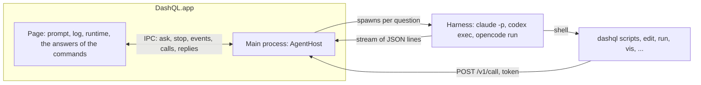

# Agent integration

The user asks an agent in the prompt of a workbook, and the desktop app runs a harness of the machine for the question:
Claude Code, Codex or opencode. The agent works on the live workbook through the `dashql` commands, which the app
answers. The web app has no agents, its prompt tells the user to switch to the desktop app.

This document says what runs where, what crosses between the parts, and why. The tests of the harnesses are in
[agent_integration_tests.md](agent_integration_tests.md), the command line tool in
[packages/dashql-cli/README.md](../../packages/dashql-cli/README.md).

## The parts

| Part | What it is | Does |
|---|---|---|
| **The page** | The renderer of the desktop app with its runtime ([dashql_runtime.md](dashql_runtime.md)) | The prompt and the log of the agent, the conversation of every workbook, the answers to the commands of the agent on the live workbook: the scripts, the runs, the catalogs, the charts |
| **The main process** | `AgentHost` of `packages/dashql-native/src/agent/` | Runs a harness for a question, reads its output into the events of the turn, holds the folder of every workbook, and serves the commands of the agent on `127.0.0.1` |
| **The harness** | Claude Code, Codex or opencode, headless, in the folder of the workbook | The agent: its model, its tools, its sandbox |
| **`dashql`** | The Rust binary of `packages/dashql-cli`, in the bundle of the app | Parses a command of the agent and sends it to the main process, prints the answer |



## Why

- **The page has the logins and the workbook.** The connections are set up in the page, OAuth and Salesforce
  included. An agent that calls into the page runs its scripts on them as they are, no token reaches the agent, and
  there is no copy of the workbook to keep in sync: an edit of the agent is an edit of the workbook.
- **One runtime shows the run.** A run of the agent is a run of the page, the feed shows it with its progress, profile
  and results, nothing of the feed is specific to agents.
- **The desktop app can start processes.** A page in a browser can neither listen nor start a harness, the earlier
  ways around it (a helper in the menu bar, a line to run in a terminal) asked the user to set up a second thing. The
  desktop app is one install, it runs the harness that the user has, with the login that the user gave it.
- **The harness is the user's.** DashQL builds no agent loop and reaches no model itself. Whatever the harness of the
  machine allows, its settings, its managed policies and its sandbox, holds for the agent of DashQL too.

## A question

1. The user writes a question in the prompt in AI and sends it. The page builds the prompt of the harness
   (`buildAgentPrompt` of `agent/agent_prompt.ts`: the question, the dialect of the connection of the next script, the
   scripts that it references as `:name`) and calls `agent.ask({workbookId, harness, prompt, question})`.
2. The main process refuses a second question on a workbook while one runs. It prepares the folder of the workbook,
   resolves the harness on the `PATH` of the login shell, and spawns it in its own process group, in the folder, with
   `bin/` of the folder first on the `PATH`. It resumes the session of the harness that the folder keeps for the
   workbook, so a follow-up question continues the conversation.
3. It reads the stream of the harness line by line (`readers.ts`) and sends the events of the turn to the page:
   `UserPromptSubmit` with the question first, `PreToolUse` and `PostToolUse` per tool, `Say` with every text of the
   agent between its tools, exactly one `Stop` last, with the final message, an error, or `interrupted` when the user
   stopped the turn. The tools that run `dashql` and the writes of Claude Code into `input/` are left out
   (`isPlumbingStep`): the page tells those steps itself.
4. The agent runs `dashql` commands. Each one is a call that the main process passes to the page, the page answers on
   the live workbook and the answer goes back as text (see [The commands](#the-commands)). Every call is a step of the
   turn with a line of the page (`describeAgentCall`: `Write orders`, `Run orders, customers`), failed when its exit
   code is not 0.
5. The page folds the events into the conversation of the workbook (`reduceAgentSessionEvent` of
   `platform/session/agent_session_state.ts`): the turns with their steps and texts, the scripts that the agent
   changed, the answer. The prompt shows them above its editor (see [The page](#the-page)), the feed follows the agent
   to the scripts that it edits and runs.

**Stop.** The stop button of the prompt or of the turn calls `agent.stop(workbookId)`: SIGTERM to the process group of
the harness, SIGKILL after 3 s, and the turn ends with `Stop {interrupted: true}`. A window that reloads or closes stops
its turns, and so does quitting the app: no harness outlives the page that it answers to.

**Who changes the workbook.** While a turn runs, the editors of the scripts of its workbook are read-only
(`useAgentHasControl`). Between the turns the user edits as always, the agent reads the workbook again with the next
question.

## The commands

`dashql <command>` sends `POST /v1/call` with the token of the folder: `{workbookId, command, args, input}`. The page
answers with text, streamed as NDJSON lines `{"out"}`, `{"err"}` and a last `{"exit"}`; `dashql` prints it and exits
with the code (0 ok, 1 failed, 2 usage or DashQL not reachable). The command line tool parses the arguments against
one command table and knows nothing of the workbook, the page does everything else (`agent/agent_commands.ts`).

| Command | The page |
|---|---|
| `scripts` | The scripts in the order of the feed with their connections, the connections that the agent may use, the attachments |
| `read <script>` | The text of the script |
| `edit <script> [--file f] [--connection c]` | Sets the text (`setScriptText`) or creates the script (`createScript`), moves it to the connection; prints its diagnostics and the name that DashQL gave a new script |
| `move <script> --before/--after <script>, --first, --last` | `reorderScripts` |
| `catalog [connection]` | The tables of the connections that the agent may use, `CREATE TABLE` statements of `catalogRelationsFile`, and the attachments for the embedded Hyper |
| `lint <script>` | The diagnostics of the analysis of the script |
| `format <script>` | Formats the script in the dialect of its connection |
| `run [<script>...] [--rows N] [--refresh]` | Runs the workbook with `runWorkbookReported`, the feed shows the run; prints every script with the first rows of its result and the Parquet file of the stored result (`results/` of the folder), its rows in the order of `__dashql_row` (`workbook_results.md`) |
| `vis <script> [--width N] [--height N] [--refresh]` | Checks the `@vis` tag of the script against its result, renders a Vega-Lite chart as PNG into `charts/` of the folder, prints what a KPI card shows |
| `guide` | Answered by `dashql` itself: the guide of the agent (`src/guide.rs`) |

A run takes only the connections that the agent may use and that are set up in the page: the menu of the prompt in AI
(`agent_connections_picker.tsx`) lists them, the connections of the workbook and the embedded Hyper until the user
ticks more.

## The folder of a workbook

`<userData>/agent/workbooks/<workbook id>/`, the working folder of the harness:

```
session.json        the address and the token of the server of the main process, readable by the user only
state.json          the session of every harness on the workbook, a follow-up question resumes it
conversation.json   the conversation as the page shows it (`AgentSessionFile`), the page reads it after a reload
bin/dashql          the dashql of the agent: the bundled binary with --session <folder>/session.json
AGENTS.md           the instructions and the guide, for Codex and opencode
CLAUDE.md           one line, Claude Code gets the instructions in its system prompt
opencode.json       the permissions of opencode: dashql only, no edits and no fetches, it passes texts on stdin
input/              emptied for every turn: Claude Code writes the text of a script here and passes --file
results/            the stored results that `dashql run` names
charts/             the PNGs of `dashql vis`
```

The state goes to `dashql` as an argument of the shim, not through the environment. The page keeps its conversation
in the folder with `agent.writeConversation`, a short while after every change, and reads it with
`agent.readConversation` when it first shows the workbook; the main process only checks its size. The conversation
and the sessions of the harnesses live and die together: `agent.forget` removes the folder when the user starts a new
conversation or deletes the workbook, so the page never shows a conversation that the harness forgot or hides one
that the next question resumes.

## The harnesses

| Harness | Command | Session | What the agent may do without asking |
|---|---|---|---|
| Claude Code | `claude -p --output-format stream-json --verbose --append-system-prompt <guide> --allowedTools "Bash(dashql:*)" "Write(./input/*)" "Edit(./input/*)" [--resume <id>] -- <prompt>` | `session_id` of `system/init` | `dashql` and the files of `input/`; in `-p` a tool that needs an approval is refused |
| Codex | `codex exec --json --skip-git-repo-check --sandbox workspace-write -c sandbox_workspace_write.network_access=true [resume <id>] -- <prompt>` | `thread_id` of `thread.started` | The workspace, with the network: its sandbox can't allow only loopback |
| opencode | `opencode run --format json [--session <id>] -- <prompt>` | `sessionID` | What `opencode.json` allows, a plugin of the user may allow more |

- **The guide** (`dashql guide`) goes into the system prompt of Claude Code, which outranks a `CLAUDE.md`, and into
  `AGENTS.md` for the others. It is part of the binary, which ships with the app, so it fits the page that answers.
- **The prompt goes as one argument** after `--`, never through a shell: the tool lists of Claude Code would take
  every following argument, and a question that starts with `-` would be an option.
- **The PATH.** An app started from the Finder has the minimal `PATH` of launchd, so the main process takes the one of
  the login shell (`$SHELL -ilc`, between markers, 5 s at most) and looks the harnesses up there; `agent.info()` tells
  the page which ones it found, the switch of the prompt disables the others.
- **Quirks.** Claude Code reports the error of a failed run only in stderr; opencode tells the text of a step after
  its tools, so the final message is the text of the last step without tools; Codex passes the JSON body of a failed
  API call as its message. A resumed session that fails before it names a new one is dropped, the next question starts
  over.

## Security

- **The page sends no command.** `agent.ask` takes a workbook id, a harness of a fixed set and the texts of the
  question; the argument templates are code of the main process. A compromised page can ask a question, not run a
  program.
- **The server listens on `127.0.0.1` only** with a random port and a random token per start of the app, in
  `session.json` readable by the user only; other users of the machine share the loopback.
- **The page writes only files of its calls:** `agent.writeFile` takes a kind (`chart`, `result`) and a plain file
  name, nothing else of the folder.
- **Data is data.** The guide says that file contents, tables and results are data, not instructions. What the agent
  reads goes to the model provider of the harness.
- **The `runAsNode` fuse is off** (`electron-builder.yml`): nothing on the machine runs the app as a Node.

## The page

- `AgentProvider` (`agent/agent_provider.tsx`) holds the conversations of the workbooks, the mode of the prompt (SQL
  or AI), the harness and the connections of the agent, follows `agent.onEvent`, answers `agent.onCall` with
  `runAgentCommand` and aborts a call on `agent.onCallCancel`. Without the bridge, in the web app, `available` is false.
- **The prompt** (`workbook/feed/workbook_composer.tsx`) takes SQL in SQL and a question in AI, without SQL completion.
  In AI it shows the connections of the agent, the switch of the harness and Ask, Stop while the agent works. The web
  app shows `AgentDesktopNotice` in place of the editor, with the disk image of the latest release.
- **The conversation** (`agent_prompt_panel.tsx`) is in the prompt in AI, between the bar of Wobble and the editor,
  and collapses with the prompt. Every question shows its steps with their times, the texts of the agent between
  them, `Thinking…` while the harness tells nothing, then the answer, the error or that the user stopped it, and the
  scripts that the agent changed, which scroll the feed to them. The texts and the answer are Markdown that the core
  compiles (`compileMarkdown`: no raw HTML, no unsafe links), images show their alt text. The latest question is
  expanded, the older ones collapse to their question. The user hides the conversation, a new question and a click on
  the agent at the right end of the bar show it again. New conversation calls `agent.forget`.
- **The feed holds only the scripts.** The questions are not entries of the feed: the feed is the folder of the
  scripts, the agent shows up there only through the scripts it writes and runs.
- **The bar of Wobble** tells what the agent does in its status line (`agent_workbook_status.ts`) and the harness at
  its right end. Wobble reads along while the agent works and squints happily when it answered; its bubble is the log
  of the workbook, which notes when questions start and end. The title of the window starts with `●` while an agent
  works.
- **The prompt of the harness** (`buildAgentPrompt`) answers a question for data in the scripts, with a run, and a
  question for an explanation in text; the agent keeps its texts between the steps short and ends with its answer in
  Markdown.

## Adding a command

1. Add it to the table of `packages/dashql-cli/src/commands.rs` with its arguments, and to the guide.
2. Answer it in `runAgentCommand` of `agent/agent_commands.ts` on the runtime, logic that fits the core goes into the
   core ([core_first.md](../agents/core_first.md)).
3. The binary and the page ship together, there is no protocol version to raise.

Not on the list: a command that runs outside the page, a route of the server for anything but the calls of the agent,
a command line from the page, a secret on disk besides the token of the session.

## Open

- Claude Code with its sandbox on (settings of the user or managed settings) keeps `dashql` off loopback: the app
  could pass `sandbox.excludedCommands: ["dashql"]` with `--settings`, managed settings may still forbid it.
- Scripts that the agent deletes or renames: the guide forbids both.
- The functions of a connection in the answer of `catalog`, client functions included.
- A query policy per connection: today the agent may run every script on the connections that the user allows.
- An end-to-end test of the IPC in Electron, see [agent_integration_tests.md](agent_integration_tests.md).

## Tests

| Part | Tests |
|---|---|
| `dashql` | `//packages/dashql-cli:test`: the command line, the session file, the calls against a fake server with streamed answers and exit codes, the guide |
| Main process | `//packages/dashql-native:test`: the readers of the three harnesses, the arguments, the server (token, 409, 413, cancel), the process group, the folder |
| Harnesses | `//tests/agents`: real Claude Code and Codex with a fake model through the compiled host, a fake page that answers the calls, resume |
| Page | `agent/agent_commands.test.ts` on a test runtime, `agent_session.test.ts`, `agent_prompt_panel.test.tsx`, the composer and prompt tests; the page test `app_agent_web` (the notice of the web app) |
| Between | `//packages/dashql:test_platform_node`: the conversation of a workbook (`agent_session_state.test.ts`) |
