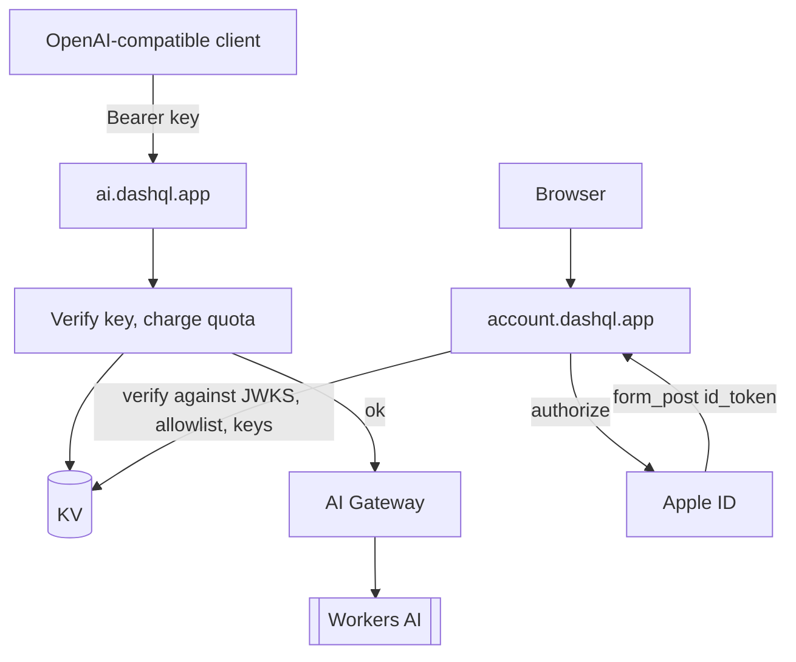

# dashql-cloud

`packages/dashql-cloud` is a Cloudflare Worker that exposes Workers AI small language models over an
OpenAI-compatible API, gated by a minimal account system. One Worker serves two hosts:

- **`ai.dashql.app`**: the machine API (`/v1/models`, `/v1/chat/completions`), authenticated by API keys.
- **`account.dashql.app`**: the browser dashboard: Sign in with Apple, then create and revoke API keys.

Workers AI is cheap (10,000 neurons per day free, then $0.011 per 1k neurons; `gemma-4-26b-a4b-it` costs
about 9.1k neurons per million input tokens). DashQL's AI settings (`packages/dashql-app/src/platform/ai/`)
work with any OpenAI-compatible endpoint, including this one; the app does not default to it.

Setup and deployment are in `packages/dashql-cloud/README.md` and `DEPLOY.md`.

## Decisions

- **No payments.** Apple Pay is only a wallet and cannot settle funds without a processor, so billing is
  deferred. The gate is an allowlist of accounts.
- **Login is Sign in with Apple**, which only needs a Services ID on the existing developer account.
  Anyone can sign in; only allowlisted accounts can create keys.
- **Rust with workers-rs.** JWT verification cannot use JS libraries, and `jsonwebtoken` depends on `ring`,
  which is unreliable on `wasm32-unknown-unknown`. Apple `id_token`s are verified with pure-Rust RS256
  (`rsa`, `sha2`, `base64`).
- **Outside the build graph.** Wrangler does not fit Bazel, so `packages/dashql-cloud` is in `.bazelignore`.
  It is the repo's only crate with a `Cargo.toml`, whose empty `[workspace]` table keeps Cargo from looking for
  a parent workspace; the Bazel crates declare dependencies with `crate.spec`. It has no `package.json`, so
  pnpm does not adopt it.
- **KV only**, no D1.

## Routing

`src/lib.rs` routes by host: hosts starting with `account.` go to the dashboard (`src/dashboard.rs`), all
others (including `ai.*` and localhost under `wrangler dev`) to the API (`src/ai.rs`).

## API

All API responses carry permissive CORS headers, and `OPTIONS` preflights are answered. Errors use the
OpenAI shape `{error: {message, type}}`.

- `GET /v1/models` requires a valid key, charges one request, and returns the static model list (currently
  `@cf/google/gemma-4-26b-a4b-it`) with `object: "model"` and `owned_by: "cloudflare"`. Workers AI's
  compatibility layer has no models endpoint.
- `POST /v1/chat/completions`, non-streaming:
  1. Verify `Authorization: Bearer <key>` (401) and the model (400 `model_not_found`).
  2. Charge the request quota up front (429 `quota_exceeded`, naming the exhausted budget).
  3. Run the model through the AI binding, routed through the AI Gateway named by `AI_GATEWAY_ID`. Inputs are
     `messages` and an optional `response_format`.
  4. Charge neurons from the returned token counts.
  5. Reshape Workers AI's `{response, usage}` into
     `{object: "chat.completion", model, choices: [{index: 0, message, finish_reason: "stop"}], usage}`.
     A `response` that arrives as a JSON object is serialized to text. Upstream failures are 502.

## Quota

Each key has two budgets per window: requests (`REQUEST_LIMIT`, default 500) and neurons (`NEURON_LIMIT`,
default 10,000). The window length `QUOTA_WINDOW_SECS` (default 5 h) is deployment-wide and read per request.

- Counters live in `DASHQL_CLOUD_API_KEY_USAGE` as `<sha256(key)>:<windowStartSecs>:r` and `…:n`, with a TTL
  of twice the window (at least 60 s). `windowStartSecs` is `now` aligned down to the window, in absolute
  epoch seconds, so changing the window on redeploy never reuses old counters.
- Neurons are counted in neuron-micros (neurons × 10⁶). The cost is `prompt_tokens × in_rate +
  completion_tokens × out_rate`, from Cloudflare's published neurons-per-million-tokens rates in `ai.rs`
  (gemma: 9091 in, 27273 out). Re-check the table when Cloudflare changes pricing.
- The neuron budget is checked first, then the request slot is charged.
- Counters are read-modify-write KV, so parallel requests on one key can under-count. Strict accounting would
  need a Durable Object.

## Sign in with Apple

The dashboard uses `response_type=code id_token`, `response_mode=form_post` and `scope=email`. Apple posts
the `id_token` back, so the Worker verifies it and never exchanges the code: no private key at runtime,
only the Services ID as audience.

1. `GET /` renders the sign-in page, or the key list for a signed-in user. Its button posts to
   `/auth/apple/login`, which redirects to Apple with `redirect_uri =
   https://account.dashql.app/auth/apple/callback`.
2. `POST /auth/apple/callback` reads the form, fetches Apple's JWKS, picks the key by `kid`, and verifies
   RS256, `iss`, `aud` and `exp` (`src/apple.rs`). The JWKS is fetched on every login.
3. The Worker issues the `dashql_session` cookie: `sub|email|expiry` signed with HMAC-SHA256
   (`SESSION_SECRET`), valid for 7 days, `HttpOnly; Secure; SameSite=Lax` (`src/session.rs`).
4. `POST /keys` (session and allowlist required) generates `dashql_` plus 43 base64url characters (256 bits),
   stores only its SHA-256, and shows the plaintext once.
5. `POST /keys/revoke` (form field `hash`) revokes a key the user owns.

SIWA only works on the deployed Worker over HTTPS with the registered return URL; Apple rejects localhost.

## Storage

| Namespace | Key | Value |
|---|---|---|
| `DASHQL_CLOUD_ACCOUNTS` | trimmed, lowercased email | `{enabled, added_at}` |
| `DASHQL_CLOUD_API_KEYS` | `sha256(key)` hex | `KeyRecord {apple_sub, email, created_at, request_limit, neuron_limit}` |
| `DASHQL_CLOUD_API_KEYS` | `owner:<apple_sub>:<sha256(key)>` | `KeyInfo {hash, created_at, request_limit, neuron_limit}` for listing |
| `DASHQL_CLOUD_API_KEY_USAGE` | `<hash>:<windowStartSecs>:r` / `:n` | request and neuron-micro counters |

- The allowlist namespace is the single source of truth for who may create keys. `{}` counts as enabled,
  `enabled: false` suspends, and a missing entry or a KV error denies. It is edited with
  `wrangler kv key put/delete`, without a redeploy.
- The allowlist is keyed by the email Apple returns, which is the private-relay address under Hide My Email.
  Keys are owned by the stable Apple `sub`, so an email change only requires a new allowlist entry.

## Build

`wrangler.jsonc` runs `worker-build --release`, which produces `build/worker/shim.mjs` plus the Wasm module.
It declares the `AI` binding, the three KV namespaces, both custom domains, and the vars `APPLE_SERVICE_ID`,
`ACCOUNT_ORIGIN`, `REQUEST_LIMIT`, `NEURON_LIMIT`, `QUOTA_WINDOW_SECS` and `AI_GATEWAY_ID`; `SESSION_SECRET`
is a secret. The release profile uses `opt-level = "s"`, LTO and one codegen unit to stay under the Workers
size limit, and does not strip, which would break wasm-bindgen. `getrandom` uses the `wasm_js` backend
(0.4) and the `js` feature (0.2, for `rsa`).

Unit tests in `apple.rs`, `session.rs`, `keys.rs` and `ai.rs` run with `cargo test` on the native target.

## Not Implemented

- Caching the Apple JWKS in KV.
- An RS256 verification test against a JWKS fixture.
- Streaming responses, embeddings, payments, and self-serve signup.
