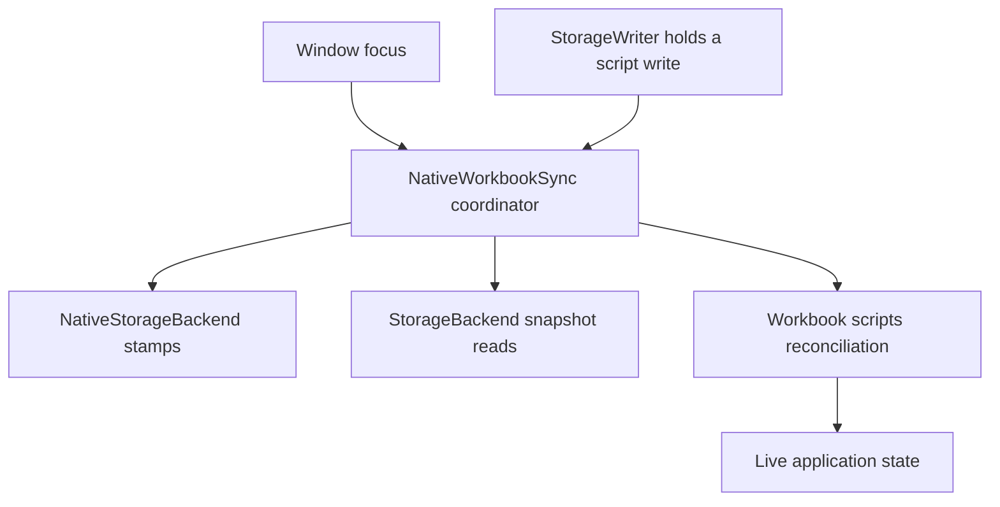
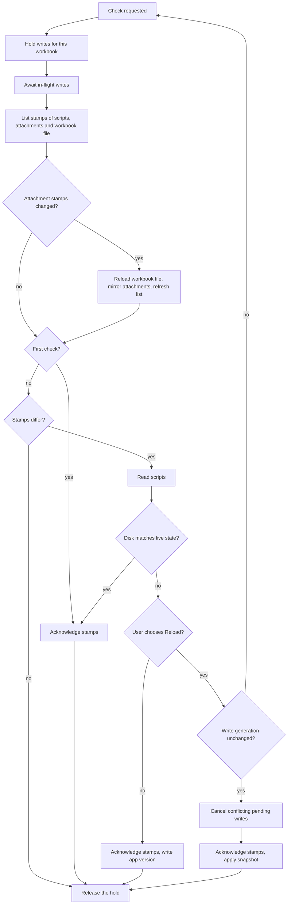

# Native File Synchronization

DashQL native workbooks live in user-owned directories. DashQL writes scripts and attachments to
those directories through a debounced `StorageWriter`; users and external tools may also edit the
same files. Native file synchronization detects those external changes and offers to reload them into
the running application without reopening the workbook.

The folders are not watched. Filesystem events are unreliable across platforms (coalesced, dropped,
lost when a watched folder is replaced, silent while the machine sleeps) and every DashQL write
would echo back as an event. Instead DashQL checks a folder at the two moments that matter: when the
window gets the focus, which is when a user returns from an editor or a terminal, and right before it
overwrites a script, which is the moment an external change would be lost.

## Goals

- Detect externally changed native scripts and attachments.
- Reload added, removed, renamed, and edited scripts.
- Preserve active connection state, query history, focus, and script identity where possible.
- Never overwrite an external change of a script without asking.
- Avoid silently discarding local debounced edits.
- Keep native concepts out of generic storage backends and the workbook of the runtime.

## Non-Goals

- Synchronizing OPFS workbooks. Browser-private storage has no supported external editor workflow.
- Showing an external change while the DashQL window keeps the focus. It is picked up on the next
  focus, or when DashQL is about to write the changed script.
- Replacing connections in place from `dashql-workbook.json`. A change of the workbook file alone is detected by its
  stamp like a script; it asks when the script list or the name differ from the app, other fields (connection
  parameters, metadata) are kept by the next write, which patches the file as it is on disk. Connection identity and
  parameters require a complete connection lifecycle and are not replaced in place.
- Watching query cache files, `.gitignore`, or other generated and unrelated files.
- Automatic text merging. A conflict is resolved by keeping the current application state or loading
  the complete external snapshot.
- Coordinating simultaneous DashQL processes editing the same native directory. The desktop app is a
  single instance; two processes on one folder see each other's writes as external changes.

## Persisted Layout

The synchronization boundary recognizes these workbook-relative paths:

```text
dashql-workbook.json
scripts/
  <script>.sql
attachments/
```

It deliberately ignores:

```text
connections/
cache/
.gitignore
<any other file>
```

Workbooks don't hold a catalog. The catalog belongs to the connection and lives in the app storage;
workbook format version 7 removed the catalog copies from workbook folders. A folder that was exported
or checked in may carry the catalogs of its connections in `connections/<id>/`. They seed the
connections that are new to the app when the folder is imported and are ignored afterwards.

The native workbook directory is resolved through `StorageReader.getWorkbookLocation`. Only locations
with `StorageBackendType.Native` and a `nativePath` are checked.

## Architecture



### Stamps

A check never reads file contents to find out whether something changed. It compares stamps: the
size and modification time of a file. The Electron bridge returns them without reading the file:

- `listFiles(dir)` lists the files of a directory with their stamps in one round trip.
- `fileStamp(path)` returns the stamp of one file, null if it does not exist.
- `writeTextFile(path, text)` resolves with the stamp of the written file.

`NativeStorageBackend` records, per script and for `dashql-workbook.json`, the stamp of its own last write or of the
last acknowledged check (`acknowledgeFolder`). A script without a stamp is known to be absent. DashQL's own writes
therefore never look like external changes, and no event correlation is needed. Every write of a file is atomic: the
bridge writes a temporary file next to it and renames it over the file, a reader never sees a part of it.

Once the folder is acknowledged, `saveScript`, `deleteScript`, `renameScript` and `saveWorkbookManifest` take the stamp
of the target file before touching it: one `fileStamp` call. A rename checks its source and its destination, so it
neither moves an external version nor replaces an external file. When the stamp differs the operation fails with
`ExternalScriptChangeError` (its `fileName` is the script or `dashql-workbook.json`) and the storage writer of the
runtime:

- keeps the task pending (a newer task with the same key supersedes it),
- holds the workbook for the change (`HoldReason::ExternalChange`), so no further write of the workbook runs,
- lists the workbook in `heldWorkbooks` of the `storage` view.

The task is executed once the hold is released, after the coordinator decided between the disk and the app. Files that
were never acknowledged are not checked; OPFS workbooks never are. A script write never creates a missing workbook
folder, e.g. one that was moved: it fails and the writer retries it.

### Coordinator

The checks are a service of the runtime of the core (`packages/dashql-core-wasm/src/runtime/external.rs`):
`checkWorkbookFolders(workbookIds)` queues checks, they run one at a time and a request for a workbook that is queued
already is dropped. The storage of the platform names the folder of a workbook (`storage.workbookFolder`, the
`NativeStorageBackend` of a native workbook) with its stamps. The runtime resolves the scripts of a folder that changed
against its connections (`resolve_workbook_scripts` of the crate): a connection that only the workbook file names joins
the runtime from its copy and leaves it again unless the reload is applied. When the scripts differ from the app, the
`storage` view asks the question (`externalChanges`: the workbook, the number of the question, whether the app holds
writes that a reload discards) and the check waits for `answerExternalChange(workbookId, prompt, reload)`.

`NativeWorkbookSync` in `packages/dashql-app/src/workbook/persistence/native_workbook_sync_react.tsx` is mounted once
in the desktop app. It asks the runtime to check

- once for every workbook that enters the list of the workbooks,
- every workbook when the window gets the focus,
- a workbook whose script write the writer holds (`heldWorkbooks` of the `storage` view),

and shows every question of the view once as a native dialog. A dialog that fails answers nothing, the version of the
app stays and the next check asks again.

### Domain Reconciliation

Workbook scripts reconciliation stays in
`packages/dashql/src/platform/workbook/scripts/workbook_scripts.ts`:

- `WorkbookScriptsStorageSnapshot` is the storage-shaped boundary type.
- `workbookScriptsMatchStorageSnapshot` detects differences in script order, connection and text.
- `replaceWorkbookScriptsFromStorage` applies a complete snapshot without persistence side effects.
- Scripts at an unchanged file path on the same connection retain their WASM script identity and query
  history. A script that moved to another connection gets a new script session in that connection's catalog.
- Added scripts allocate new WASM state; removed scripts are detached from the catalog before destruction.
- Changed script text clears stale completion and pending-diff buffers.
- The focused script is retained when its path still exists; otherwise focus falls back to the first
  script in workbook order.
- Any workbook change invalidates affected workbook analysis. Scripts are reanalyzed on
  demand when an editor, execution, or diagnostics flow needs current analysis.

## Check Protocol



A check of the runtime follows these steps for one workbook at a time:

1. Hold that workbook's debounced writes (`HoldReason::Reload`). Other workbooks continue normally.
2. Await writes that already started.
3. List the stamps of `scripts/` and `attachments/` and take the stamp of `dashql-workbook.json`, three round trips
   without reading a file.
4. When the attachment stamps changed since the previous check, load the workbook file, which mirrors
   the attachments into the workbook's OPFS namespace for embedded HyperDB-WASM, and refresh the
   attachment list of the workbook file.
5. The first check of a workbook acknowledges the stamps: the restoration read the scripts and the
   workbook file moments before, they are what the app shows.
6. Compare the stamps with the recorded ones. No difference ends the check. Otherwise read the scripts
   and the workbook file and compare the scripts and the name with the live state. If they match, e.g.
   because a tool only touched a file or changed another field of the workbook file, acknowledge the
   stamps and end the check. A scripts folder that is gone or empty while the workbook file lists
   scripts decides nothing, a later check reads it again. A workbook that another task holds is checked
   again a moment later instead of being taken as changed.
7. Ask the user whether to reload: the `storage` view holds the question until the app answers. When
   relevant local writes are pending, the dialog explicitly says that reloading discards them. A local
   edit that arrives while a question without pending writes is open asks again with that warning.
8. **Keep current** acknowledges the stamps and writes the app version of every script that differs.
   Scripts that exist only on disk are left alone.
9. **Reload** rechecks the relevant write generation after the dialog. The editor remains
   interactive while a native dialog is open; if another local edit was scheduled, the old decision
   is stale and the workbook is requeued for a fresh snapshot and decision.
10. Cancel only conflicting pending workbook writes when the user accepted that consequence,
    acknowledge the stamps, and reconcile the workbook, its name included.
11. Release the hold of the check at the end of every check, also a failed one. A check that settled the disk also
    releases the hold of a write that found a changed file. A held write runs now: after Keep current it overwrites
    the acknowledged disk version, after Reload it was cancelled.

## Writer Coordination

`StorageWriter` remains the authority for outbound writes. Native synchronization adds these narrowly
scoped capabilities:

- **Holds with reasons:** a hold of the writer or of one workbook carries a reason (external change, reload, import,
  handover, pause) and is counted, each is released on its own. A check releases the hold it took, not the one of an
  open question.
- **Scoped pending writes:** callers can inspect or cancel keys selected by a predicate.
- **Write generations:** every scheduled key receives a monotonic generation used to invalidate a
  conflict decision made while a dialog was open.
- **Held writes:** a write that fails with `ExternalScriptChangeError` stays pending in a held
  workbook, see above.

Global `flush()` (when the page hides, before a window closes, on a handover) writes past a hold of the writer, never
past the hold of a workbook: a write that a change outside the app, a reload or an import holds stays pending. A
failed write stays pending as well and runs again after a backoff, the `storage` view lists it with its last error
(`failedWrites`).

Storage write keys are workbook-rooted logical paths, so conflict cancellation cannot affect
`dashql-workbook.json` or another workbook.

## Conflict Semantics

There are four relevant versions:

| Version | Meaning |
| --- | --- |
| Live state | Current connection and workbook state visible in DashQL |
| Pending writes | Newer local state scheduled but not yet persisted |
| Recorded stamps | The stamps of what DashQL last wrote or acknowledged on disk |
| Disk snapshot | Stable read taken after in-flight writes have settled |

The policies are:

- If the disk stamps match the recorded ones, do nothing. Pending writes run as usual.
- If a stamp differs but the disk matches the live state, acknowledge the stamps silently.
- If disk differs externally and there are no pending local writes, ask whether to reload.
- If disk differs externally and local writes are pending, ask whether to reload and discard only
  those conflicting pending writes.
- If local writes change while the dialog is open, discard the decision, reread disk, and decide from
  a fresh state.
- Choosing **Keep current** makes the application version win: the differing scripts are written
  again and pending writes run.

## Failure Handling

- A failed check (e.g. a moved or deleted folder) is logged as a warning and leaves live state
  unchanged. The next focus retries it.
- The hold of a check is released in all success, rejection, and failure paths.
- Taking a stamp before a write treats only a missing file as absent; any other error fails the
  write like before.
- Checks for workbooks no longer present in the registries are harmless; there is no state to replace.

Filesystem saves are not transactional snapshots. A check that reads an editor's half-written file
compares unequal and prompts; the user can keep the current version and the next focus checks again.

## Security and Permissions

The checks use the `dashql:fs` bridge (`listFiles` and `fileStamp` beside the existing operations) and
only read directories already registered as native DashQL workbooks. There is no watcher in the main
process.

## Testing

Focused tests cover:

- Detection of external edits, deletions, additions and touches by stamps, against own writes,
  renames and acknowledgements.
- Refusing writes, deletes and renames that would lose an external change.
- Unchecked writes for scripts that were never acknowledged.
- Holding a refused write in a held workbook until the hold is released, and superseding it.
- Detection of order-only and connection-only changes.
- Same-path script identity preservation and added/changed content reconciliation.

Relevant Bazel targets:

```bash
bazel test //packages/dashql-app:tsc_typecheck_test
bazel test //packages/dashql-app:test_chromium //packages/dashql-app:test_firefox
bazel build //packages/dashql-native:compile
```

## Known Limitations

- `dashql-workbook.json` changes to connections require reopening the workbook.
- Reload is snapshot replacement, not a three-way merge or per-file conflict UI.
- Stamps are process-local. The first check after a restart acknowledges whatever the folder holds.
- A stamp misses an external edit that keeps the size and lands within the modification time
  resolution of the file system after DashQL's own write (coarse on FAT and some network shares).
- An external change made while DashQL has the focus appears on the next focus or on the next write
  of the changed script.
- Every focus lists two directories of every open native workbook.

## Implementation References

- Checks: `packages/dashql-core-wasm/src/runtime/external.rs`, the dialogs: `packages/dashql-app/src/workbook/persistence/native_workbook_sync_react.tsx`
- Stamps and refused script writes: `packages/dashql/src/platform/storage/native_storage_backend.ts`
- Holds, held and failed writes: `packages/dashql-core-runtime/src/storage/writer.rs`
- Workbook scripts reconciliation: `resolve_workbook_scripts` of `packages/dashql-core-runtime/src/workbook_format/script_connections.rs`, `Workbook::replace_from_storage` of `packages/dashql-core-runtime/src/workbook.rs`
- Electron filesystem bridge: `packages/dashql-native/src/main.ts` and `src/preload.cjs`
- Stamp tests: `packages/dashql/src/platform/storage/native_storage_backend.test.ts`
- Writer tests: `packages/dashql-core-runtime/tests/storage_writer_test.rs`
- Workbook scripts reconciliation tests: `packages/dashql-core-runtime/tests/workbook_test.rs`, the dialogs: `packages/dashql-app/src/workbook/persistence/native_workbook_sync.test.tsx`
