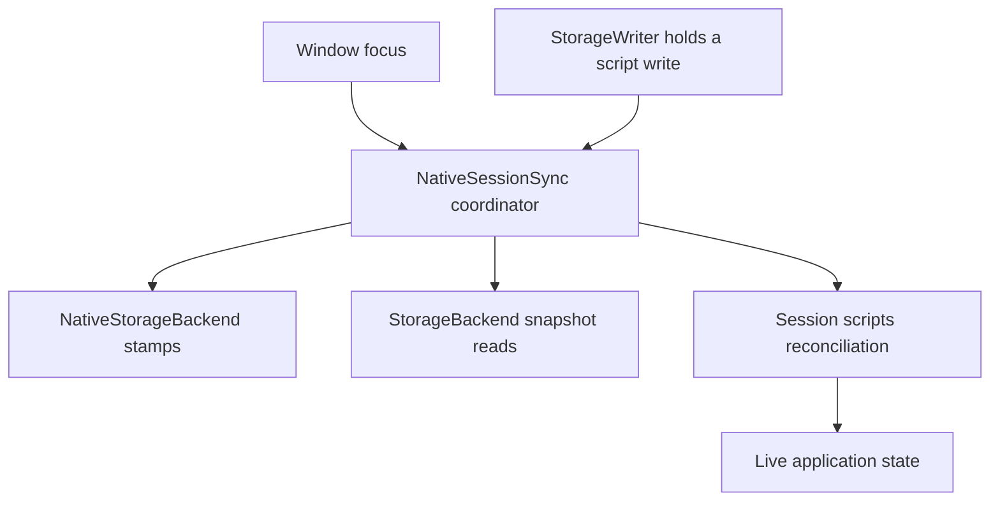
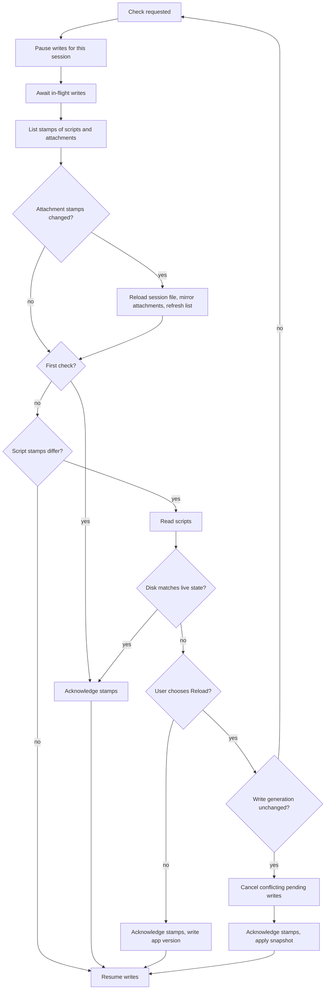

# Native File Synchronization

DashQL native sessions live in user-owned directories. DashQL writes scripts and attachments to
those directories through a debounced `StorageWriter`; users and external tools may also edit the
same files. Native file synchronization detects those external changes and offers to reload them into
the running application without reopening the session.

The folders are not watched. Filesystem events are unreliable across platforms (coalesced, dropped,
lost when a watched folder is replaced, silent while the machine sleeps) and every DashQL write
would echo back as an event. Instead DashQL checks a folder at the two moments that matter: when the
window gets the focus, which is when a user returns from an editor or a terminal, and right before it
overwrites a script, which is the moment an external change would be lost.

## Goals

- Detect externally changed native scripts and attachments.
- Reload added, removed, renamed, and edited scripts.
- Preserve active connection state, query history, focus, and script identity where possible.
- Never overwrite an external change of a script without asking.
- Avoid silently discarding local debounced edits.
- Keep native concepts out of generic storage backends and session reducers.

## Non-Goals

- Synchronizing OPFS sessions. Browser-private storage has no supported external editor workflow.
- Showing an external change while the DashQL window keeps the focus. It is picked up on the next
  focus, or when DashQL is about to write the changed script.
- Detecting edits of `dashql-session.json` alone (script order, connections, name). The script list
  is read again with the next detected script change; connection identity and parameters require a
  complete connection lifecycle and are not replaced in place. Writes patch the session file and keep
  fields they don't own.
- Watching query cache files, `.gitignore`, or other generated and unrelated files.
- Automatic text merging. A conflict is resolved by keeping the current application state or loading
  the complete external snapshot.
- Coordinating simultaneous DashQL processes editing the same native directory. The desktop app is a
  single instance; two processes on one folder see each other's writes as external changes.

## Persisted Layout

The synchronization boundary recognizes these session-relative paths:

```text
dashql-session.json
scripts/
  <script>.sql
attachments/
```

It deliberately ignores:

```text
connections/
cache/
.gitignore
<any other file>
```

Sessions don't hold a catalog. The catalog belongs to the connection and lives in the app storage;
session format version 7 removed the catalog copies from session folders. A folder that was exported
or checked in may carry the catalogs of its connections in `connections/<id>/`. They seed the
connections that are new to the app when the folder is imported and are ignored afterwards.

The native session directory is resolved through `StorageReader.getSessionLocation`. Only locations
with `StorageBackendType.Native` and a `nativePath` are checked.

## Architecture



### Stamps

A check never reads file contents to find out whether something changed. It compares stamps: the
size and modification time of a file. The Electron bridge returns them without reading the file:

- `listFiles(dir)` lists the files of a directory with their stamps in one round trip.
- `fileStamp(path)` returns the stamp of one file, null if it does not exist.
- `writeTextFile(path, text)` resolves with the stamp of the written file.

`NativeStorageBackend` records, per script, the stamp of its own last write or of the last
acknowledged check (`acknowledgeScripts`). A script without a stamp is known to be absent. DashQL's
own writes therefore never look like external changes, and no event correlation is needed.

Once the scripts are acknowledged, `saveScript`, `deleteScript` and `renameScript` take the stamp of
the target file before touching it: one `fileStamp` call. A rename checks its source and its
destination, so it neither moves an external version nor replaces an external file. When the stamp
differs the operation fails with `ExternalScriptChangeError` and the `StorageWriter`:

- keeps the task pending (a newer task with the same key supersedes it),
- pauses the session, so no further write of the session runs,
- notifies the `subscribeExternalChanges` subscribers.

The task is executed once the session resumes, after the coordinator decided between the disk and
the app. Scripts that were never acknowledged are not checked; OPFS sessions never are.

### Coordinator

`NativeSessionSync` in
`packages/dashql-app/src/app/session/persistence/native_session_sync_react.tsx` is mounted once inside the
connection and session registry providers. It queues a session check

- once for every session that enters the session registry,
- for every session when the window gets the focus,
- for a session whose script write the writer holds.

Checks are serialized: repeated requests for a session collapse in a `Set` and only one native dialog
is open at a time. The coordinator is the only component that knows about native dialogs, storage
coordination, and both state registries.

### Domain Reconciliation

Session scripts reconciliation stays in
`packages/dashql-app/src/app/session/scripts/session_scripts.ts`:

- `SessionScriptsStorageSnapshot` is the storage-shaped boundary type.
- `sessionScriptsMatchStorageSnapshot` detects content and page-structure differences.
- `replaceSessionScriptsFromStorage` applies a complete snapshot without persistence side effects.
- Scripts at unchanged page/file paths retain their WASM script identity and query history.
- Added scripts allocate new WASM state; removed scripts are detached from the catalog before destruction.
- Changed script text clears stale completion and pending-diff buffers.
- Existing page/script focus is retained when that path still exists; otherwise focus falls back to
  the first sorted entry.
- Any session change invalidates affected session analysis. Scripts are reanalyzed on
  demand when an editor, execution, or diagnostics flow needs current analysis.

## Check Protocol



The coordinator follows these steps for one session at a time:

1. Pause that session's debounced writes. Other sessions continue normally.
2. Await writes that already started.
3. List the stamps of `scripts/` and `attachments/`, two round trips without reading a file.
4. When the attachment stamps changed since the previous check, load the session file, which mirrors
   the attachments into the session's OPFS namespace for embedded HyperDB-WASM, and refresh the
   attachment list of the session file.
5. The first check of a session acknowledges the script stamps: the restoration read the scripts
   moments before, they are what the app shows.
6. Compare the script stamps with the recorded ones. No difference ends the check. Otherwise read
   the scripts and compare them with the live state. If they match, e.g. because a tool only touched
   a file, acknowledge the stamps and end the check.
7. Ask the user whether to reload. When relevant local writes are pending, the dialog explicitly says
   that reloading discards them.
8. **Keep current** acknowledges the stamps and writes the app version of every script that differs.
   Scripts that exist only on disk are left alone.
9. **Reload** rechecks the relevant write generation after the dialog. The editor remains
   interactive while a native dialog is open; if another local edit was scheduled, the old decision
   is stale and the session is requeued for a fresh snapshot and decision.
10. Cancel only conflicting pending session writes when the user accepted that consequence,
    acknowledge the stamps, and reconcile the session.
11. Resume the session writer in a `finally` block. A held write runs now: after Keep current it
    overwrites the acknowledged disk version, after Reload it was cancelled.

## Writer Coordination

`StorageWriter` remains the authority for outbound writes. Native synchronization adds these narrowly
scoped capabilities:

- **Session pause:** `pauseSession` and `resumeSession` hold timers only for one session.
- **Scoped pending writes:** callers can inspect or cancel keys selected by a predicate.
- **Write generations:** every scheduled key receives a monotonic generation used to invalidate a
  conflict decision made while a dialog was open.
- **Held writes:** a write that fails with `ExternalScriptChangeError` stays pending in a paused
  session, see above.

Global `flush()` remains a hard drain. It force-processes pending tasks even when a session is paused,
which preserves shutdown and storage-migration semantics. A flushed write that would overwrite an
external change is held like any other.

Storage write keys are session-rooted logical paths, so conflict cancellation cannot affect
`dashql-session.json` or another session.

## Conflict Semantics

There are four relevant versions:

| Version | Meaning |
| --- | --- |
| Live state | Current connection and session state visible in DashQL |
| Pending writes | Newer local state scheduled but not yet persisted |
| Recorded stamps | The stamps of what DashQL last wrote or acknowledged on disk |
| Disk snapshot | Stable read taken after in-flight writes have settled |

The policies are:

- If the disk stamps match the recorded ones, do nothing. Pending writes run as usual.
- If a stamp differs but the disk matches the live state, acknowledge the stamps silently.
- If disk differs externally and there are no pending local writes, ask whether to reload.
- If disk differs externally and local writes are pending, ask whether to reload and discard only
  those conflicting pending writes.
- If local writes change while the dialog is open, discard the decision, reread disk, and decide from
  a fresh state.
- Choosing **Keep current** makes the application version win: the differing scripts are written
  again and pending writes run.

## Failure Handling

- A failed check (e.g. a moved or deleted folder) is logged as a warning and leaves live state
  unchanged. The next focus retries it.
- Session writes are resumed in all success, rejection, and failure paths.
- Taking a stamp before a write treats only a missing file as absent; any other error fails the
  write like before.
- Checks for sessions no longer present in the registries are harmless; there is no state to replace.

Filesystem saves are not transactional snapshots. A check that reads an editor's half-written file
compares unequal and prompts; the user can keep the current version and the next focus checks again.

## Security and Permissions

The checks use the `dashql:fs` bridge (`listFiles` and `fileStamp` beside the existing operations) and
only read directories already registered as native DashQL sessions. There is no watcher in the main
process.

## Testing

Focused tests cover:

- Detection of external edits, deletions, additions and touches by stamps, against own writes,
  renames and acknowledgements.
- Refusing writes, deletes and renames that would lose an external change.
- Unchecked writes for scripts that were never acknowledged.
- Holding a refused write in a paused session until it resumes, and superseding it.
- Detection of page-only structural changes.
- Same-path script identity preservation and added/changed content reconciliation.

Relevant Bazel targets:

```bash
bazel test //packages/dashql-app:tsc_typecheck_test
bazel test //packages/dashql-app:test_chromium //packages/dashql-app:test_firefox
bazel build //packages/dashql-native:compile
```

## Known Limitations

- `dashql-session.json` changes to connections require reopening the session.
- Reload is snapshot replacement, not a three-way merge or per-file conflict UI.
- Stamps are process-local. The first check after a restart acknowledges whatever the folder holds.
- A stamp misses an external edit that keeps the size and lands within the modification time
  resolution of the file system after DashQL's own write (coarse on FAT and some network shares).
- An external change made while DashQL has the focus appears on the next focus or on the next write
  of the changed script.
- Every focus lists two directories of every open native session.

## Implementation References

- Check coordinator: `packages/dashql-app/src/app/session/persistence/native_session_sync_react.tsx`
- Stamps and refused script writes: `packages/dashql-app/src/app/storage/native_storage_backend.ts`
- Held writes: `packages/dashql-app/src/app/storage/storage_writer.ts`
- Session scripts reconciliation: `packages/dashql-app/src/app/session/scripts/session_scripts.ts`
- Electron filesystem bridge: `packages/dashql-native/src/main.ts` and `src/preload.cjs`
- Stamp tests: `packages/dashql-app/src/app/storage/native_storage_backend.test.ts`
- Writer tests: `packages/dashql-app/src/app/storage/storage_writer.test.ts`
- Session scripts reconciliation tests: `packages/dashql-app/src/app/session/scripts/session_scripts.test.ts`
