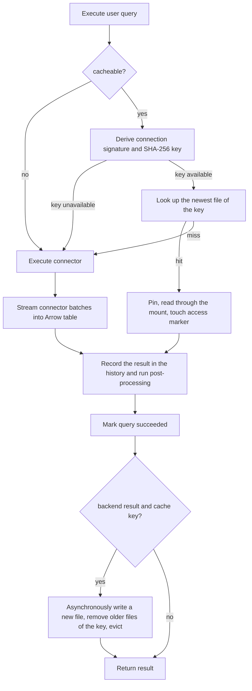

# Query Result Cache

DashQL caches successful user-query results in Parquet files of the origin private file system, one cache for the whole app. A repeat of the same executable SQL against the same connection can load the cached result without contacting the backend. The cache is an optimization: cache lookup, read, eviction, and write failures do not make a query fail.

## Scope

The cache stores a result table as Parquet file, written and read by the compute database (hyperdb-wasm) whatever connection ran the query. The cache needs a compute database that mounts directories (`supportsParquet`) and a `QueryResultCache` that the platform passes to `createRuntime` as `resultCache` (the app takes it from `QueryResultCacheProvider`, `useQueryResultCache()`), and it applies only when the caller opts in through `QueryExecutionArgs.cacheable` and passes the script signature of the key (`cacheSignature`). Without a cache nothing is cached.

Every connection decides whether its query results are cached: the toggle **Cache query results** in the connection settings, applied right away (`setQueryResultCaching`). The app manifest keeps the choice in the connection entry (`cacheQueryResults`); without a choice the connector decides (`ConnectorFeatures` of `connections/params.rs` in the core runtime: off for Hyper, on for Salesforce, Database.com and Trino), and the view of the connection carries the decision (`cachesQueryResults`).

Single-script runs opt in when the connection of the script caches results: explicit execution, execute-on-send, reruns, and refreshes, all through `runScript` of the runtime (`packages/dashql-core-wasm/src/runtime/runs.rs`). A run of a script executes a plan of the script like a run of the workbook executes the plan of every script (`packages/dashql-core-runtime/src/workbook_run/`): it derives the result keys from the plan and, for a script whose key is reusable and cached and that follows no script that runs, runs only the terminal query of the script with `cacheOnly`: the executor serves it from the cache and never runs it on the backend, since the query holds only after the statements before it. If the file is gone meanwhile, the executor fails with a `QueryCacheMissError` and the script runs. A script that runs has read the cache already: the terminal query of a script with a reusable key runs with `cacheable`, `refreshCache` and the signature of its key, the executor runs it on the backend and writes its result as the newest file of the key, and the other statements run without. A refresh (`refresh` of `runScript`) reads no cache entries (see Script References below). Shell queries never opt in: the workbook shell sets `cacheable: false`, and the standalone shell runs its statements on its connection to the embedded Hyper without `cacheable`. Internal catalog, setup, and health-check queries also do not set the flag and therefore never read or write the cache. Merely loading or viewing a workbook does not execute queries or read cached results; a user-triggered execution is required.

**Execute All** also runs while connections of the workbook aren't connected (`can_run` of the host of the run, the connections that are online when the run starts). A script whose connection can't run doesn't run, so it doesn't keep the scripts after it from serving their cached results: the script can't change what they read during the run. The scripts of such a connection serve their cached results, the others are skipped with every statement that follows them, also a scan of the embedded Hyper that reads one of them. A script runs completely or not at all. The run counts the skipped scripts (`WorkbookExecutionState.skippedScripts`, `skippedFiles`), the status shows `3/5 completed · 2 need a connection`, its tooltip names the scripts, and the connections of the workbook pulse in the bar once a run of the open page settles. A run stops if a connection drops that it runs statements on. A connection that is connecting holds the run, it would join a moment later. A change of inputs runs the same way, a script whose input changed usually has a new key and needs its connection. The run of a single script still waits for its connections. A run starts once the compute database is set up (`ready` of `useWorkbookExecution`, Execute All stays disabled until then): it reads the cached files, before its setup every script would miss. The log of a run that skipped scripts names each one with the reason and the key it looked for, a key that differs from the names in an imported file, e.g. one of another version of the app, shows there.

The cache is deliberately not a general consistency mechanism. It assumes that a result is a pure function of its connection signature and executable script AST. Only scripts whose statements are all `SELECT` or `EXPLAIN` are cacheable: a hit skips the complete script, so a script with commands before its terminal query, such as `CREATE TABLE t AS ...; SELECT * FROM t`, always executes. `CREATE TABLE`, `CREATE VIEW`, and other terminal commands always execute too.

## Cache Key

Each entry is addressed by a lowercase SHA-256 digest:

```
SHA-256("dashql-query-cache-v3" + framed(stableJson(connectionParamsSignature), scriptAstSignature))
```

The runtime derives the key in Rust (`executor::cache_key` of `dashql-core-runtime`, `Connections::result_key` of the bindings): `connection_cache_signature` produces the connector-specific signature from the setup params of the connection and excludes transient connection state, `result_key_input` sorts the object keys recursively to make the serialization independent of insertion order and frames both signatures by their lengths in UTF-16 code units, the lengths of the strings of JavaScript that keyed the files before. The platform computes the digest (`crypto.sha256`). DashQL core derives the script signature from the parser output: statement order, identifiers, literals, operators, and AST structure participate, while whitespace, comments, source offsets, and parser allocation IDs do not. All statements contribute, including commands preceding the terminal result statement. A cache hit skips the complete script.

The plan of a script records its AST signature and whether it is cacheable (`ExecutionGraphScript.signature` and
`cacheable`). A script that references other scripts with table parameters (`:foo`, see `script_references.md`)
caches its result under a signature that appends the keys of the referenced scripts to its AST signature, one per
line. The AST signature of a script that binds inputs is followed by their literals, `:min=10` per line
(`workbook_inputs.md`), a new value is a new key. A script that reads attachments is followed by their stamps,
`attachment sales.parquet=<stamp>` per line, a changed file is a new key; the keys of the scripts it references cover
the attachments they read. Every planned script has a result key (`result_keys` in `workbook_run/plan.rs` of the core runtime). The key is reusable, i.e. a run may serve
a cached file of the key instead of running the script, if the script is cacheable, its connection caches results,
and the keys of the scripts it references are reusable. A referenced script is a single SELECT, so it is cacheable;
one on a connection that doesn't cache results makes the script not reusable either, and so does a referenced call of
a client function, which is never cacheable.

For a terminal query with `@vis` tags, the signature excludes the tags, they are comments. Result analysis and visualization projection run after cache loading, so visualization-only edits can reuse the same raw result.

Result analysis and visualization projection are not part of the key. The executor always runs post-processing after either a cache hit or a backend result, allowing the same raw table to support the relevant analysis flow.

The connection signature keys results per login: a result is the result of the user who ran the query, row-level
security or the sharing rules of Salesforce may show another user other rows of the same tables. The signature
(`connection_cache_signature`) reads the connection, not only its params. A Trino connection with basic auth is keyed
by its user; one with OAuth by the account of its token, the `sub` of the token response or of its OpenID Connect id
token (the default scopes ask for `openid`). A Salesforce or Database.com connection is keyed by the account that the
user info of its login named. A login hint that the user typed never keys a result: while the account is unknown,
e.g. when the user info failed or before the connection is set up again after a reload, the results get no reusable
key, they are neither read from the cache nor written. The credentials stay out, a new token of the same login reuses
the cached results.

A Hyper connection is keyed by its endpoint, its attached databases and its session settings, the headers of its
metadata stay out. The Hyper of a link (`V3_HTTP_LINK`, e.g. `hyperd run --ui`) adds the fingerprint of the token of
its link (FNV-1a of the token, the token stays out): every run of hyperd prints a new link, so another Hyper that
listens on the same port later never serves the results of an earlier one. Without the token of the link in the tab
the results of the link get no reusable key. Files that an older version wrote under another signature are misses,
they age out of the cache.

If the executor cannot recover connection parameters or derive a signature, it treats the query as non-cacheable and executes normally. Key derivation is also best-effort and must not expose an error to the query path.

## Storage Layout

The query result cache belongs to the app, not to a workbook: every workbook and connection writes into the folder
`cache/` at the root of the origin private file system, also native workbooks. `createOPFSQueryResultCache`
(`packages/dashql/src/platform/storage/opfs_query_result_cache.ts`) implements the `QueryResultCache` interface
(`packages/dashql/src/platform/query/query_result_cache.ts`). The platform passes it to `createRuntime` as `resultCache`,
the executor and the runs of the runtime use it through `resultCache` and `mounts` of the platform object.

```
cache/
  <hash>.<uuid>.parquet
  <hash>.<uuid>.parquet.last_access
  <uuid>.transient.parquet
```

A write of a key creates a file with a new name, `<hash>.<uuid>.parquet`, and a lookup finds the newest file of a
key. A transient file, `<uuid>.transient.parquet`, has no key: it holds a materialized result that can't be reused or
a file of a key that is being written. A transient file that nobody pins is garbage, every listing of the folder
removes it. A file keeps its content once it is complete: the compute database remembers the files it read, so a path is
never reused for other bytes. The file's modification time is the entry's cached-at time. The empty companion
`.last_access` records the most recent read in its modification time.

The compute database mounts the folder read-write at `/mnt/external/cache`. Hyper writes a file with `COPY ... TO`
into the mount and reads it with `select * from external('/mnt/external/cache/<name>', format => 'parquet')`,
fetching the byte ranges it needs from disk. A file of a key is written as a transient file and moved to its
name once it is complete, so readers never see a partial file.

Readers pin the files they read with a shared Web Lock named `dashql-query-result-cache/<name>`, which spans the
windows of the app. A write pins its new file and its temporary file too. Eviction and deletion remove a file only if
they get the exclusive lock at once (`ifAvailable`), pinned files stay. The release of a pin resolves once the lock is
released, so a run can remove its own files right after releasing them.

Every window has its own compute database and mounts the folder itself. In a window, readers and writers share one
mount (`QueryResultCache.mount`), which is set up on first use and stays. The compute database remembers the file of
every path it opened below the mount and doesn't notice files that JavaScript removes or rewrites. Unique names keep
these remembered files valid while they exist. After this window removed files, the next use of the mount refreshes it
(`refreshExternalDirectory`, `MountedResource.refresh` of hyperdb-wasm), so the database looks the paths up again and
forgets the removed files. A refresh doesn't wait for readers: queries that run keep reading the files they opened.
Once they finished, the database releases the files it opened before the refresh, so the mount, which stays for the
life of the window, doesn't hold on to every file it ever read. A new compute database, e.g. after a restart of
hyperdb-wasm, gets a new mount.

Native workbook folders keep the entries `cache/` and `*.hyper` in a top-level `.gitignore`, so the cache folders of
earlier versions stay out of version control. It is written with the workbook file, and missing entries are appended
to an existing `.gitignore`, so the user's own lines stay.

Workbook bundles, duplication, transfer, and storage migration do not copy cache files, only an exported `.dashql` file
carries them on request (Exported Results below). Deleting a workbook leaves the
cached results of its scripts, eviction removes them. The cache folders that OPFS workbooks of earlier versions kept
(`workbooks/<workbook-uuid>/cache/`) are no part of the layout: the storage cleanup of the internals lists them
(`findOPFSCleanupCandidates`), and deleting a workbook removes its folder.

## Execution Flow



The query is in the history of its connection before the runtime describes it: the key is computed after the registration.

On a cache hit, the executor reads the newest file of the key through the mounted cache folder while the file is
pinned (`QueryResultCache.readTable`), and the history records it like the result of a streamed query, with empty metadata and zeroed stream metrics; then the shared analysis and success path runs. It records the cache key, cached-at timestamp, and `servedFromCache` state for the UI. A cache hit also asynchronously rewrites the empty access marker; it never rewrites the potentially large payload.

On a miss, the executor streams the backend result into an Arrow table as usual. After the query succeeds, or after only the analysis of its result failed, the compute database writes the table as new file of the key into the mounted cache folder (`QueryResultCache.writeTable`, `resultCache.write` resolves with the name of the file), then the older files of the key are removed and eviction runs. The caller is not blocked on the write or the eviction scan. A write whose file survived the eviction records the cache key on the finished query; a file that the eviction removed right away, e.g. a result larger than the cache, and a failed write only produce a log message.

Cancellation during an asynchronous cache lookup is treated like any other cancellation, the query ends at once. A read runs to its end, the run of the query owns the table that it read, then the query ends as cancelled. Cache lookup, read and write failures are logged and fall back to normal execution where applicable: an entry that cannot be read is a miss.

## Script References

A script that references a script of another connection reads the result of that script as a Parquet file of the
cache folder (`script_references.md`). The planner takes the file names from the host (`materializationFile`) and
scans `/mnt/external/cache/<name>`. A materialized result is a file of the result key of its script if the key is
reusable, a transient file otherwise:

- A run scans the newest file of a reusable key that is cached (`materialized` of the plan), the producer doesn't
  run unless it follows a script of the plan that runs (`script_references.md`). The run pins the file from the
  lookup on until it ends (`QueryResultCache.retain`, `pin` of the `mounts` of the platform).
- Otherwise the producer runs. Its terminal node writes its result as a new file of its key if the key is reusable
  (`fileName` of the `mounts` of the platform, `QueryResultCache.newFileName`), the file replaces the older files of the key. A
  result whose key isn't reusable, or a script without a key, e.g. on a connection whose signature is unknown, is a
  transient file (`QueryResultCache.newTransientFileName`).
- A refresh runs every producer anew and writes its result the same way.

The run pins every file it writes or reads until it settled, then it removes its transient files. The runtime keeps
the pins of a run by their ids and releases them through `resultCache.release` (`workbook_run/engine.rs`), the platform
only maps an id to the release of its pin (`query/cache_pins.ts`) and releases the pins that are left when the runtime
is destroyed. Transient files that a closed window left behind are nobody's pins any more, the next listing in any
window removes them.

## Exported Results

The **Query Results** toggle of the export of a `.dashql` file, off by default, adds the cached results of the scripts
to the archive, e.g. to hand a slow dashboard with its data to someone without access to its connections. Every result
is a table of its own, `workbook_result_<id>.parquet`, and a row of `workbook_results` names its cache key
(`workbook_tables.md`).
An archive may carry `results/<key>.parquet` instead, an import reads them. The export of the runtime plans
the workbook without analyzing it, like the cache indicators of the cards, and takes the newest file of every reusable
key (`resultKeys`, `resultCache.retain` of the platform), retained until the archive holds it (`exportWorkbook` with
`results`). The overlay packs the archive without results whenever the workbook or the settings change and shows its
size plus the sizes of the results (`exportedResults`). The results go in when the file is saved, a pack that is no
longer needed is ignored. The archive stores the files without compressing them again. Links never carry results, an
import of a link drops them.

Neither side holds the results in memory. The export streams each file of the cache into the archive, and the archive
into a Blob that the browser keeps and pages out. The import reads the central directory of the dropped file, a stored
result is a byte range of it, and streams each range into a file of the cache. A result that another tool compressed
when it repacked the archive is inflated into memory. The archives are read and written with zip.js on the main
thread: its inline worker is a `blob:` script that the pages don't allow (`app_csp.md`), and its wasm codec isn't
needed, the browser deflates and inflates with `CompressionStream`.

An import adds the files to the cache of the app once the connections of the workbook are resolved (`commitImport`
of the runtime through `resultCache.import` of the platform, `QueryResultCache.importFile`), as new files of their keys. A key that is cached already keeps its files, the results
of the app win, also a result that a run writes while the import streams the bytes of its key. The import checks the
CRC-32 that the archive stores for each stored result while it streams it, a result that differs leaves no file. The
results beyond the capacity of the cache are left out, they would evict each other; the import may evict the least
recently read results of the app. Each result succeeds or fails on its own, a failure leaves the others and the
import alone, the log names each one.

The card of a dropped file shows the summary of the file on the left and the steps of the import on the right, drawn
like the steps of the setup of the app (`SetupSteps`): Read File, Check Archive, Resolve Connections, Add Query Results
(only for a file with results, with how many are in the cache) and Save Workbook. The first three run on their own
(`readImport`, which writes nothing and may ask which existing connections to use); the card then asks to
Import, or to Replace or Create New if a workbook with the same id is registered. The import adds the results and saves
the workbook (`commitImport`, its `onStep` reports the steps). A failed step is marked. If some results
weren't added, the card stays open as Workbook Imported with how many and why, and the first error, until the user opens
the workbook: their scripts need a connection. An import that replaces a registered workbook reloads the app, its card is
gone then and only the log tells.

A key covers the connection signature and the script, not the ids of the workbook or its connections, so a result of
the archive is found by the same script on a connection with the same signature, also on a connection of the app that
the import reused. The signatures of Salesforce, Database.com and Trino connections don't change when the params are
shared, they need the account of a login on the connection that reads them. Those of Hyper servers do: the shared params leave out the TLS files and the query parameters, and Hyper
connections cache no results unless the user asks for it, so their results don't travel.

- An imported file is a new file, its cached-at time is the time of the import.
- The results hold query data, the toggle says so. The credentials of the connections stay out of the file, the data
  doesn't.
- A file can name the key of any connection with the same signature: an archive from someone else can put results
  in front of the backend of a connection of the app until Refresh replaces them. Import files only from people you
  trust.
- A failed export shows its error in the export overlay.

## Capacity and Eviction

The cache of the app has these defaults:

| Limit | Default |
| --- | ---: |
| Total payload bytes | 2 GiB |
| Payload files | 1000 |

The runtime evicts after every write of a file of a key: the result of a query that the executor writes, the materialized result of a run under a reusable key, and an imported result (`evict_to_fit` of `workbook_format/eviction.rs`, `JsPlatform::evict_cache` of the bindings). It lists all payload files through the cache of the platform (`resultCache.files`), totals their sizes, and removes least-recently-used entries (`resultCache.remove`) until the retained entries fit the limits of the cache (`resultCache.capacity`). A file that is read stays, the next one goes instead. It sorts on the `.last_access` marker modification time. If the marker is missing, the payload modification time is used, so an entry falls back to write-time ordering. A failed eviction is logged, the write stands. The cache of the platform only lists, sizes and removes files.

The policy counts and sizes every Parquet file of the folder, also the transient files that are pinned, i.e. written or read right now; access markers do not count as entries. Deleting an entry removes its payload and marker. Every listing also removes orphaned markers left behind by a crash or another window.

Eviction is best-effort and non-transactional. Concurrent writers can observe approximate totals, concurrent deletion of an entry is tolerated, and pinned files may keep the cache above its limits until they are released. A later write evicts them if necessary.

## User Experience

For a succeeded result, the query result header shows its execution age. When the result was served from cache, that age is based on the payload's original write time rather than the latest cache access.

The **Refresh** action runs the script again without reading cached results (`runScript` with `{ refresh: true }`): the script and every script of its plan run on their backends, also a materialized script whose result is cached. Their results with reusable keys become the newest files of their keys, which replace the older files once nobody reads them. A refresh that fails leaves the cached results as they were.

The internals overlay includes a **Query Cache** tab. It lists the cached results of the app with key, size, cached-at time, and last-access time; provides manual refresh of the listing; and allows deleting individual entries or clearing the cache, which leaves the files that are being read. The list omits `.last_access` markers and transient files. Feed rows show whether a cached result exists: the script view carries `cachedResult` (the key and when its newest file was written), which the runtime looks up (`runs/cached_results.rs` of the core module) under the reusable keys of the scripts. A workbook is looked up once its changes paused and only if what its keys depend on changed: the analyses of its scripts, its attachments, its connections and their params, the cache keys of its latest queries; a move of the cursor looks up nothing. A cache entry that a query recorded or deleted looks up the workbooks of its connection again, the end of a run and an eviction every workbook, since their scripts may share the keys. It plans the current analyses and keeps what it showed while an analysis is outdated.

## Limits and Correctness

- Cache identity is scoped by the connection signature and a versioned semantic AST signature, but not by a TTL, backend data version, or catalog version.
- The cache may return stale data after a backend changes. Use Refresh to invalidate a visible result, or change the SQL/signature to create a new key.
- The key of a script covers the keys of the scripts it references, not their data. A change of the text of `foo.sql` changes the key of `foo.sql` and of every script that references it, so those miss. A new result of `foo.sql` with the same text doesn't: Refresh of `foo.sql`, or a run of it after its backend data changed, writes a new file under the same key, and `bar.sql`, which references it, keeps serving the result it computed from the old data of `foo.sql` until `bar.sql` is refreshed too. Naming the newest file of a reusable referenced key in the key of its consumers, instead of only the key, would close the gap at the cost of keys that depend on the content of the cache.
- Corrupt files are not self-healed by automatic deletion. They are misses and stay until the next write of the key replaces them or they are removed from Refresh or the cache inspector.
- A duplicate write for the same hash is safe because both writers represent the same key: each writes a file of its own, the newest one stays.
- The cache preserves raw results only. Analyses and projections run again after cache load.

## Implementation References

- Key derivation: `packages/dashql-core-runtime/src/executor/cache_key.rs`, the signatures of the connectors in `hyper/descriptor.rs`, `trino/descriptor.rs` and `salesforce/mod.rs`
- Cache contract: `packages/dashql/src/platform/query/query_result_cache.ts`
- OPFS implementation: `packages/dashql/src/platform/storage/opfs_query_result_cache.ts`
- Executor integration: `packages/dashql-core-wasm/src/runtime/queries.rs` (the executor of the runtime, the description of a query and its key) and `packages/dashql/src/runtime/query/query_channels.ts` (the files of the platform)
- Eviction policy: `packages/dashql-core-runtime/src/workbook_format/eviction.rs`, run by the runtime after the writes of files of keys (`evict_cache` of `packages/dashql-core-wasm/src/host.rs`) over `files`, `remove` and `capacity` of the cache of the platform
- Files of runs: `createRunMounts` in `packages/dashql/src/runtime/workbook/scripts/run_mounts.ts`, the `mounts` of the platform of the runtime
- Cache inspection UI: `packages/dashql-app/src/workbook/persistence/query_cache_view.tsx`
- Exported and imported results: `packages/dashql-core-wasm/src/runtime/exports.rs` and `imports.rs`, the plan of an
  import in `packages/dashql-core-runtime/src/workbook_format/query_results.rs`
- Archives: `packages/dashql/src/runtime/storage/workbook_archives.ts` over `workbook/persistence/workbook_zip.ts`
