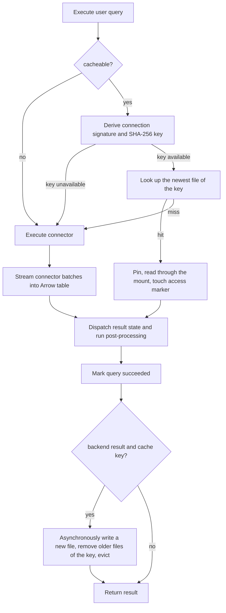

# Query Result Cache

DashQL caches successful user-query results in Parquet files of the origin private file system, one cache for the whole app. A repeat of the same executable SQL against the same connection can load the cached result without contacting the backend. The cache is an optimization: cache lookup, read, eviction, and write failures do not make a query fail.

## Scope

The cache stores a result table as Parquet file, written and read by the compute database (hyperdb-wasm) whatever connection ran the query. The cache needs a compute database that mounts directories (`supportsParquet`) and a `QueryResultCacheProvider` above the executor, and it applies only when the caller opts in through `QueryExecutionArgs.cacheable` and passes the script signature of the key (`cacheSignature`). Without a provider, `useQueryResultCache()` is null and nothing is cached.

Every connection decides whether its query results are cached: the toggle **Cache query results** in the connection settings, applied right away (`SET_CONNECTION_QUERY_RESULT_CACHING`). The app manifest keeps the choice in the connection entry (`cacheQueryResults`); without a choice the connector decides (`features.queryResultCaching`: off for Hyper, on for Salesforce, Database.com and Trino, `connectionCachesQueryResults`).

Single-script session executions opt in when the connection of the script caches results: explicit execution, execute-on-send, reruns, and refreshes, all through `runSessionScript`, and the runs of the agent through `runSessionScriptForResult` (`packages/dashql-app/src/session/scripts/rerun_query.ts`). A run of a script executes a plan of the script like a run of the session executes the plan of every script (`runSessionPlan`, `packages/dashql-app/src/session/scripts/session_execution.ts`): it derives the result keys from the plan and, for a script whose key is reusable and cached and that follows no script that runs, runs only the terminal query of the script with `cacheOnly`: the executor serves it from the cache and never runs it on the backend, since the query holds only after the statements before it. If the file is gone meanwhile, the executor fails with a `QueryCacheMissError` and the script runs. A script that runs has read the cache already: the terminal query of a script with a reusable key runs with `cacheable`, `refreshCache` and the signature of its key, the executor runs it on the backend and writes its result as the newest file of the key, and the other statements run without. A refresh (`ScriptRunOptions.refresh`) reads no cache entries (see Script References below). Shell queries never opt in: the session shell sets `cacheable: false`, and the standalone shell executes directly against its embedded database connection. Internal catalog, setup, and health-check queries also do not set the flag and therefore never read or write the cache. Merely loading or viewing a session does not execute queries or read cached results; a user-triggered execution is required.

The cache is deliberately not a general consistency mechanism. It assumes that a result is a pure function of its connection signature and executable script AST. Only scripts whose statements are all `SELECT` or `EXPLAIN` are cacheable: a hit skips the complete script, so a script with commands before its terminal query, such as `CREATE TABLE t AS ...; SELECT * FROM t`, always executes. `CREATE TABLE`, `CREATE VIEW`, and other terminal commands always execute too.

## Cache Key

Each entry is addressed by a lowercase SHA-256 digest:

```
SHA-256("dashql-query-cache-v3" + framed(stableJson(connectionParamsSignature), scriptAstSignature))
```

`createConnectionParamsSignature` produces the connector-specific signature and excludes transient connection state. Before hashing, `computeQueryResultCacheKey` recursively sorts object keys to make serialization independent of insertion order. DashQL core derives the script signature from the parser output: statement order, identifiers, literals, operators, and AST structure participate, while whitespace, comments, source offsets, and parser allocation IDs do not. All statements contribute, including commands preceding the terminal result statement. A cache hit skips the complete script.

The plan of a script records its AST signature and whether it is cacheable (`ExecutionGraphScript.signature` and
`cacheable`). A script that references other scripts with table parameters (`:foo`, see `script_references.md`)
caches its result under a signature that appends the keys of the referenced scripts to its AST signature, one per
line. The AST signature of a script that binds inputs is followed by their literals, `:min=10` per line
(`session_inputs.md`), a new value is a new key. A script that reads attachments is followed by their stamps,
`attachment sales.parquet=<stamp>` per line, a changed file is a new key; the keys of the scripts it references cover
the attachments they read. Every planned script has a result key (`computeScriptResultKeys`). The key is reusable, i.e. a run may serve
a cached file of the key instead of running the script, if the script is cacheable, its connection caches results,
and the keys of the scripts it references are reusable. A referenced script is a single SELECT, so it is cacheable;
one on a connection that doesn't cache results makes the script not reusable either.

For a terminal query with `@vis` tags, the signature excludes the tags, they are comments. Result analysis and visualization projection run after cache loading, so visualization-only edits can reuse the same raw result.

Result analysis and visualization projection are not part of the key. The executor always runs post-processing after either a cache hit or a backend result, allowing the same raw table to support the relevant analysis flow.

If the executor cannot recover connection parameters or derive a signature, it treats the query as non-cacheable and executes normally. Key derivation is also best-effort and must not expose an error to the query path.

## Storage Layout

The query result cache belongs to the app, not to a session: every session and connection writes into the folder
`cache/` at the root of the origin private file system, also native sessions. `createOPFSQueryResultCache`
(`packages/dashql-app/src/storage/opfs_query_result_cache.ts`) implements the `QueryResultCache` interface
(`packages/dashql-app/src/query/query_result_cache.ts`), and `QueryResultCacheProvider` hands it to the executor and
the session runs.

```
cache/
  <hash>.<uuid>.parquet
  <hash>.<uuid>.parquet.last_access
  <uuid>.transient.parquet
```

A write of a key creates a file with a new name, `<hash>.<uuid>.parquet`, and a lookup finds the newest file of a
key. A transient file, `<uuid>.transient.parquet`, has no key: it holds a materialized result that can't be reused or
a file of a key that is being written. A transient file that nobody pins is garbage, every listing of the folder
removes it. A file keeps its content once it is complete: the compute database remembers the files it read, so a path is
never reused for other bytes. The file's modification time is the entry's cached-at time. The empty companion
`.last_access` records the most recent read in its modification time.

The compute database mounts the folder read-write at `/mnt/external/cache`. Hyper writes a file with `COPY ... TO`
into the mount and reads it with `select * from external('/mnt/external/cache/<name>', format => 'parquet')`,
fetching the byte ranges it needs from disk. A file of a key is written as a transient file and moved to its
name once it is complete, so readers never see a partial file.

Readers pin the files they read with a shared Web Lock named `dashql-query-result-cache/<name>`, which spans the
windows of the app. A write pins its new file and its temporary file too. Eviction and deletion remove a file only if
they get the exclusive lock at once (`ifAvailable`), pinned files stay. The release of a pin resolves once the lock is
released, so a run can remove its own files right after releasing them.

Every window has its own compute database and mounts the folder itself. In a window, readers and writers share one
mount (`QueryResultCache.mount`), which is set up on first use and stays. The compute database remembers the file of
every path it opened below the mount and doesn't notice files that JavaScript removes or rewrites. Unique names keep
these remembered files valid while they exist. After this window removed files, the next use of the mount refreshes it
(`refreshExternalDirectory`, `MountedResource.refresh` of hyperdb-wasm), so the database looks the paths up again and
forgets the removed files. A refresh doesn't wait for readers: queries that run keep reading the files they opened.
Once they finished, the database releases the files it opened before the refresh, so the mount, which stays for the
life of the window, doesn't hold on to every file it ever read. A new compute database, e.g. after a restart of
hyperdb-wasm, gets a new mount.

Native session folders keep the entries `cache/` and `*.hyper` in a top-level `.gitignore`, so the cache folders of
earlier versions stay out of version control. It is written with the session file, and missing entries are appended
to an existing `.gitignore`, so the user's own lines stay.

Session bundles, duplication, transfer, and storage migration do not copy cache files. Deleting a session leaves the
cached results of its scripts, eviction removes them. The cache folders that OPFS sessions of earlier versions kept
(`sessions/<session-uuid>/cache/`) are no part of the layout: the storage cleanup of the internals lists them
(`findOPFSCleanupCandidates`), and deleting a session removes its folder.

## Execution Flow



The cacheable path computes the key before query state is registered.

On a cache hit, the executor reads the newest file of the key through the mounted cache folder while the file is
pinned (`QueryResultCache.readTable`), dispatches the same completed-result state used by a streamed query with empty metadata and zeroed stream metrics, then enters the shared analysis and success path. It records the cache key, cached-at timestamp, and `servedFromCache` state for the UI. A cache hit also asynchronously rewrites the empty access marker; it never rewrites the potentially large payload.

On a miss, the executor streams the backend result into an Arrow table as usual. After the query succeeds, the compute database writes the table as new file of the key into the mounted cache folder (`QueryResultCache.writeTable`), then the older files of the key are removed and eviction runs. The caller is not blocked on the write or the eviction scan. A successful write records the cache key on the finished query, while a failed write only produces a log warning.

Cancellation during an asynchronous cache read is treated like any other cancellation. Cache lookup, read and write failures are logged and fall back to normal execution where applicable: an entry that cannot be read is a miss.

## Script References

A script that references a script of another connection reads the result of that script as a Parquet file of the
cache folder (`script_references.md`). The planner takes the file names from the host (`materializationFile`) and
scans `/mnt/external/cache/<name>`. A materialized result is a file of the result key of its script if the key is
reusable, a transient file otherwise:

- A run scans the newest file of a reusable key that is cached (`materialized` of the plan), the producer doesn't
  run unless it follows a script of the plan that runs (`script_references.md`). The run pins the file from the
  lookup on until it ends (`QueryResultCache.retain`, `ExecutionMounts.use`).
- Otherwise the producer runs. Its terminal node writes its result as a new file of its key if the key is reusable
  (`ExecutionMounts.fileName`, `QueryResultCache.newFileName`), the file replaces the older files of the key. A
  result whose key isn't reusable, or a script without a key, e.g. on a connection whose signature is unknown, is a
  transient file (`QueryResultCache.newTransientFileName`).
- A refresh runs every producer anew and writes its result the same way.

The run pins every file it writes or reads until it ends, then it removes its transient files. Transient files that a
closed window left behind are nobody's pins any more, the next listing in any window removes them.

## Capacity and Eviction

The cache of the app has these defaults:

| Limit | Default |
| --- | ---: |
| Total payload bytes | 2 GiB |
| Payload files | 1000 |

After a write, `evictToFit` lists all payload files, totals their sizes, and deletes least-recently-used entries until the retained entries fit. Pinned files are skipped. It sorts on the `.last_access` marker modification time. If the marker is missing, the payload modification time is used, so an entry falls back to write-time ordering.

The policy counts and sizes every Parquet file of the folder, also the transient files that are pinned, i.e. written or read right now; access markers do not count as entries. Deleting an entry removes its payload and marker. Every listing also removes orphaned markers left behind by a crash or another window.

Eviction is best-effort and non-transactional. Concurrent writers can observe approximate totals, concurrent deletion of an entry is tolerated, and pinned files may keep the cache above its limits until they are released. A later write evicts them if necessary.

## User Experience

For a succeeded result, the query result header shows its execution age. When the result was served from cache, that age is based on the payload's original write time rather than the latest cache access.

The **Refresh** action runs the script again without reading cached results (`runSessionScript` with `{ refresh: true }`): the script and every script of its plan run on their backends, also a materialized script whose result is cached. Their results with reusable keys become the newest files of their keys, which replace the older files once nobody reads them. A refresh that fails leaves the cached results as they were.

The internals overlay includes a **Query Cache** tab. It lists the cached results of the app with key, size, cached-at time, and last-access time; provides manual refresh of the listing; and allows deleting individual entries or clearing the cache, which leaves the files that are being read. The list omits `.last_access` markers and transient files. Feed rows show whether a cached result exists (`hasCachedResult`, `QueryResultCache.has`) under the reusable key of a run of the script (`computeScriptResultCacheKey`), which plans the current analysis without analyzing outdated scripts.

## Limits and Correctness

- Cache identity is scoped by the connection signature and a versioned semantic AST signature, but not by a TTL, backend data version, or catalog version.
- The cache may return stale data after a backend changes. Use Refresh to invalidate a visible result, or change the SQL/signature to create a new key.
- The key of a script covers the keys of the scripts it references, not their data. A change of the text of `foo.sql` changes the key of `foo.sql` and of every script that references it, so those miss. A new result of `foo.sql` with the same text doesn't: Refresh of `foo.sql`, or a run of it after its backend data changed, writes a new file under the same key, and `bar.sql`, which references it, keeps serving the result it computed from the old data of `foo.sql` until `bar.sql` is refreshed too. Naming the newest file of a reusable referenced key in the key of its consumers, instead of only the key, would close the gap at the cost of keys that depend on the content of the cache.
- Corrupt files are not self-healed by automatic deletion. They are misses and stay until the next write of the key replaces them or they are removed from Refresh or the cache inspector.
- A duplicate write for the same hash is safe because both writers represent the same key: each writes a file of its own, the newest one stays.
- The cache preserves raw results only. Analyses and projections run again after cache load.

## Implementation References

- Key derivation: `packages/dashql-app/src/query/query_result_cache_key.ts`
- Cache contract: `packages/dashql-app/src/query/query_result_cache.ts`
- OPFS implementation: `packages/dashql-app/src/storage/opfs_query_result_cache.ts`
- Executor integration: `packages/dashql-app/src/connections/query_executor.tsx`
- Eviction policy: `packages/dashql-app/src/storage/query_result_cache_eviction.ts`
- Files of runs: `createExecutionMounts` in `packages/dashql-app/src/session/scripts/session_execution.ts`
- Cache inspection UI: `packages/dashql-app/src/session/persistence/query_cache_view.tsx`
