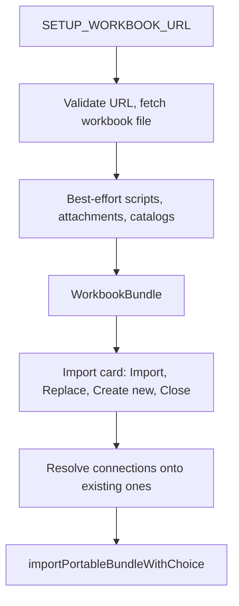

# Workbook Publishing

DashQL workbooks can be published as ordinary, reviewable files on any static host with CORS, such as
GitHub Pages, without a `.dashql` archive or a database. A link points https://dashql.app at the workbook file, and
the app imports the tree as an editable local workbook. The other ways to share a workbook are listed in
`workbook_tables.md`.

## Published Tree

A published workbook is a workbook folder (see `storage_layout.md`) plus the catalogs of its connections:

```text
dashql-workbook.json
scripts/
  01_setup.sql
  02_report.sql
attachments/
  sales.parquet
connections/<connection-id>/
  dashql-catalog-relations.sql
  dashql-catalog-functions.sql
```

Static HTTP servers cannot enumerate folders, so `dashql-workbook.json` lists the scripts and attachments
(schema `proto/json/dashql/app_workbook.json`):

```json
{
  "formatVersion": 11,
  "workbookId": "…",
  "connections": [
    { "connectionId": "22bdfa32-…", "params": { "…": "…" } },
    { "connectionId": "9f0c6e1a-…", "params": { "…": "…" } }
  ],
  "scripts": [
    { "name": "01_setup.sql", "connectionId": "22bdfa32-…" },
    { "name": "02_report.sql", "connectionId": "9f0c6e1a-…" }
  ],
  "attachments": [{ "name": "sales.parquet" }],
  "metadata": { "…": "…" }
}
```

- `connections` holds a copy of every connection the scripts use and nothing else, in the order the scripts
  first use them, so the tree is self-contained. A workbook without scripts holds the one connection its first
  script will run on. Unlisted script files run on the connection of the script before them. Exports drop the
  connections that no script uses.
- A connection may carry the `name` the user gave it. Only exports write it, the app manifest keeps the names of
  the connections of the app (see Imported Connections).
- An embedded database (`"protocol": "WASM"`) is never a choice on import: the app holds a single connection
  to its embedded Hyper, every embedded database of an imported workbook uses it.
- The script list is authoritative for the order of the scripts and for the connection each script is
  analyzed and executed with. File names carry no meaning: a numeric prefix like `01_` is an ordinary part
  of the name, and reordering scripts only rewrites the list.
- The attachment list is kept in natural order.
- `connections/<id>/` carries the relation and function catalogs of each connection of the workbook
  (`bundle_catalog_path`, `packages/dashql-core-runtime/src/workbook_format/bundle.rs`). Bundles of format 6 and older carry top-level catalog files, which
  are read for the default connection of that format.

## Reconciling Lists and Files

Every loader, local or remote, reconciles the lists with the files it finds, with the workbook format of the core
runtime (`packages/dashql-core-runtime/src/workbook_format/files.rs`):

- `sanitize_workbook_files` drops entries with unsafe names (empty, longer than 255 characters, separators, NUL,
  `.` or `..`), non-`.sql` scripts, `dashql-draft.sql`, and invalid connection ids. Duplicates are detected
  case-insensitively, the hosts pass the names of their listings in NFC; the first wins. Lists are capped at 2048
  entries.
- `reconcile_workbook_scripts` drops entries without a file, adopts the file's spelling for case variants,
  and appends unlisted script files in natural order on the default connection.
- A script whose connection cannot be resolved runs on the default connection, and the workbook file keeps
  its original reference (`script_connections.rs`). Unused connections are pruned from the list.

Older formats are migrated: v5 moved the order of `dashql-workbook-index.json` into the script list, v6
turned `mainDatabase` and `attachedDatabases` into the connection list, and v7 moved the catalogs out of the
workbook folder into the connections (`packages/dashql-core-runtime/src/workbook_format/migration.rs`). Remote workbooks of older
formats are migrated in memory.

## Links and Loading

A published link carries the URL of the workbook file:

```text
https://dashql.app/?workbook=https%3A%2F%2Fowner.github.io%2Frepository%2Fexample%2Fdashql-workbook.json
```

The `workbook` parameter (or the legacy `session` and `notebook`) is consumed with `history.replaceState` before any
asynchronous work, so a refresh does not repeat the import
(`packages/dashql-app/src/platform/events/event_listener_provider.tsx`). Pasting a DashQL link and opening
an example raise the same `SETUP_WORKBOOK_URL` event.



`readWorkbookBundleFromHttp` (`packages/dashql-app/src/workbook/persistence/http_workbook_bundle.ts`):

- accepts public `https:` URLs and loopback `http:` in development builds, without credentials or fragment,
  ending in `dashql-workbook.json` (or the legacy `dashql-session.json` and `dashql-notebook.json`),
- requires only the workbook file; listed scripts, attachments and catalogs are optional and skipped when
  unavailable, so stale lists degrade gracefully,
- builds file URLs as `scripts/<name>`, `attachments/<name>` and `connections/<id>/<file>` relative to the
  workbook file, so all fetches stay below its directory on the same origin,
- fetches with `credentials: 'omit'`: plain `GET`s without cookies, authorization or custom headers,
- limits the workbook file to 1 MiB, each script and catalog to 8 MiB, and the total to 32 MiB. Over budget,
  all optional files are dropped and only the workbook metadata is imported,
- reports the workbook as incomplete when entries were dropped, files were missing, or the budget was
  exceeded.

The app loads the bundle during setup with progress phases and shows it on a `WorkbookImportCard`
(`packages/dashql-app/src/app/loading/shared_workbook_import.tsx`,
`packages/dashql-app/src/workbook/persistence/workbook_import_card.tsx`), including where a workbook with the same
UUID already lives. Imported catalogs are parse-validated and only seed connections that have no catalog
yet.

The imported tree becomes an editable OPFS workbook. Its metadata records `HTTP` provenance and the original
URL; later edits do not write back to the host.

## UUID Collisions

Remote trees use the portable import path of `.dashql` files and inline ZIP links
(`packages/dashql-app/src/workbook/persistence/workbook_import_provider.tsx`):

- No conflict: keep the published UUID.
- Create new: allocate a fresh UUID and append ` (copy)` to a non-empty name.
- Replace: stage the bundle under a fresh UUID, verify it, then swap it in
  (`packages/dashql-app/src/storage/workbook_import_transaction.ts`).
- Close: no storage changes.

OPFS and registered native workbooks both participate in the UUID check.

## Imported Connections

Exports give every connection a fresh id, so an import finds the connections of the app by their params
(`plan_connection_import`, `packages/dashql-core-runtime/src/workbook_format/connection_import.rs`):

- A connection that the app knows under the same id and the same params (ignoring secrets) is used silently.
- A server connection whose params match connections of the app asks the user whether to use one of them or
  keep a connection of its own. Unknown connections are registered.
- A registered connection takes the exported name, the restoration moves it from the workbook file into the app
  manifest. A connection that uses one of the app keeps the name of the app.
- An embedded database (`"protocol": "WASM"`) always uses the embedded database of the app, without a question.
  Its id is rewritten in `connections`, in the `connectionId` of every script and in the names of its catalogs.
  The restoration of the app does the same for an embedded database with an unknown id
  (`resolveWorkbookConnection`, `packages/dashql-runtime/src/workbook/persistence/app_state_loader.ts`).

**Open problem: attached databases of the embedded database.** The params of an embedded database may list
`attachedDatabases` (e.g. `tpch.hyper`). An imported workbook takes the params of the embedded database of the
app, so the databases that the workbook attached are dropped and scripts that read from them fail until the user
attaches them again. Before the app held a single embedded database, such a workbook registered an embedded
database of its own. A solution could merge the attached databases into the embedded database of the app or
attach them per workbook; it has to settle what happens when two workbooks attach different files under the
same alias.

## GitHub URL Forms

GitHub Pages:

```text
https://owner.github.io/repository/path/dashql-workbook.json
```

Raw GitHub also works, but the URL must include a branch, tag, or commit:

```text
https://raw.githubusercontent.com/owner/repository/main/path/dashql-workbook.json
```

Public GitHub Pages and Raw responses provide `Access-Control-Allow-Origin: *`.
